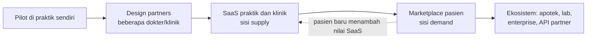
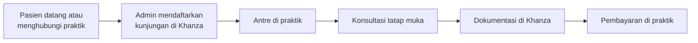
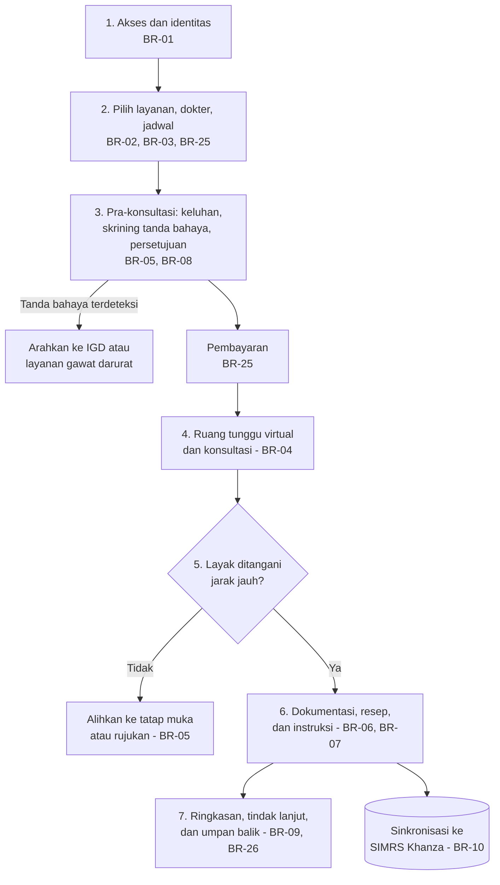
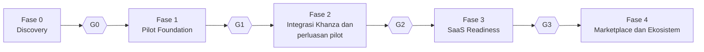

# Business Requirements Document (BRD)

## Platform Telemedicine Indonesia — Personal Practice Pilot menuju SaaS Healthcare

| Atribut | Keterangan |
|---|---|
| **Nama Dokumen** | Business Requirements Document (BRD) |
| **Proyek** | Platform Telemedicine Indonesia — Personal Practice Pilot menuju SaaS Healthcare |
| **Kode Dokumen** | BRD-TMD-001 |
| **Versi** | 1.0 |
| **Status** | Final — Baseline untuk Persetujuan (Sign-off) |
| **Tanggal** | 24 November 2026 |
| **Klasifikasi** | Rahasia — Internal |
| **Pemilik Dokumen** | Pemrakarsa / Dokter Pemilik Praktik (Business Owner) |
| **Pasar Awal** | Indonesia |
| **Pilot Awal** | Praktik Mandiri Dokter — penggunaan internal |
| **Sistem Saat Ini** | SIMRS Khanza melalui jaringan lokal (LAN) |
| **Arah Produk** | Platform mandiri (standalone), API-first, SaaS-ready |

> [!NOTE]
> Dokumen ini menetapkan **kebutuhan dan hasil bisnis** yang ingin dicapai. Desain teknis, struktur database, kontrak API, pilihan vendor, dan harga final ditetapkan pada dokumen lanjutan (lihat [2.5 Dokumen Terkait](#25-dokumen-terkait)).

---

## Informasi Dokumen

### Riwayat Revisi

| Versi | Tanggal | Penyusun | Ringkasan Perubahan |
|---|---|---|---|
| 0.1 | 24 November 2026 | Pemrakarsa | Draft awal untuk ditinjau. |
| 1.0 | 24 November 2026 | Pemrakarsa / Tim Produk | Restrukturisasi ke format BRD standar; tujuan bisnis terukur; kriteria penerimaan per requirement; NFR terukur; matriks peran dan hak akses; register risiko berperingkat; stage gate; matriks keterlacakan; perluasan benchmark (Practo, Doctolib) dan pembaruan telaah regulasi. Rincian di [Lampiran C](#lampiran-c--catatan-perubahan-dari-versi-01). |

### Daftar Distribusi

| Penerima | Peran | Tujuan Distribusi |
|---|---|---|
| Pemrakarsa / Dokter Pemilik Praktik | Business Owner, Product Owner | Persetujuan dan pengambilan keputusan |
| Clinical Reviewer | Penelaah klinis | Telaah keselamatan pasien dan batas layanan klinis |
| Technical Reviewer / Technical Lead | Penelaah teknis | Telaah kelayakan teknis, integrasi, dan keamanan |
| Legal / Regulatory Reviewer | Penelaah hukum dan regulasi | Telaah kepatuhan, perizinan, dan pelindungan data |
| Admin / Asisten Praktik | Pengguna kunci | Validasi alur operasional praktik |

---

## Daftar Isi

1. [Ringkasan Eksekutif](#1-ringkasan-eksekutif)
2. [Pendahuluan](#2-pendahuluan)
3. [Konteks Bisnis](#3-konteks-bisnis)
4. [Strategi Benchmark ATM (Amati, Tiru, Modifikasi)](#4-strategi-benchmark-atm-amati-tiru-modifikasi)
5. [Tujuan Bisnis dan Ukuran Keberhasilan](#5-tujuan-bisnis-dan-ukuran-keberhasilan)
6. [Ruang Lingkup](#6-ruang-lingkup)
7. [Pemangku Kepentingan dan Pengguna](#7-pemangku-kepentingan-dan-pengguna)
8. [Proses Bisnis](#8-proses-bisnis)
9. [Kebutuhan Bisnis](#9-kebutuhan-bisnis)
10. [Kebutuhan Non-Fungsional](#10-kebutuhan-non-fungsional)
11. [Kebutuhan Data, Integrasi, dan Pelaporan](#11-kebutuhan-data-integrasi-dan-pelaporan)
12. [Aturan Bisnis](#12-aturan-bisnis)
13. [Kepatuhan dan Regulasi](#13-kepatuhan-dan-regulasi)
14. [Model Bisnis dan Strategi Go-to-Market](#14-model-bisnis-dan-strategi-go-to-market)
15. [Roadmap Implementasi dan Stage Gate](#15-roadmap-implementasi-dan-stage-gate)
16. [Asumsi, Batasan, dan Ketergantungan](#16-asumsi-batasan-dan-ketergantungan)
17. [Manajemen Risiko](#17-manajemen-risiko)
18. [Keputusan Terbuka](#18-keputusan-terbuka)
19. [Persetujuan Dokumen](#19-persetujuan-dokumen)
20. [Glosarium](#20-glosarium)
- [Lampiran A — Matriks Keterlacakan](#lampiran-a--matriks-keterlacakan)
- [Lampiran B — Referensi](#lampiran-b--referensi)
- [Lampiran C — Catatan Perubahan dari Versi 0.1](#lampiran-c--catatan-perubahan-dari-versi-01)

---

## 1. Ringkasan Eksekutif

### 1.1 Gambaran Umum

Dokumen ini mendefinisikan kebutuhan bisnis untuk membangun **platform telemedisin** yang pertama-tama diuji dalam Praktik Mandiri Dokter milik pemrakarsa, kemudian dikembangkan menjadi **produk SaaS** yang dapat digunakan dokter dan fasilitas pelayanan kesehatan (fasyankes) lain di Indonesia.

Produk dirancang sebagai aplikasi mandiri yang mencakup layanan pasien dan dokter: konsultasi jarak jauh, penjadwalan, dokumentasi klinis, resep, pembayaran, dan integrasi. Pada tahap pilot, aplikasi berperan sebagai **sistem tambahan**; SIMRS Khanza tetap menjadi sistem operasional praktik.

### 1.2 Peluang Bisnis

- Pasien membutuhkan cara praktis untuk membuat janji dan berkonsultasi jarak jauh tanpa harus datang untuk setiap kebutuhan tindak lanjut.
- Dokter praktik mandiri dan klinik belum memiliki ruang kerja digital yang menyatukan jadwal, konsultasi, dokumentasi, dan pembayaran **tanpa mengganti SIMRS** yang sudah berjalan.
- Regulasi mendukung arah ini: PP 28/2024 memungkinkan fasyankes, termasuk praktik mandiri tenaga medis, menyelenggarakan telemedisin, dan Permenkes 24/2022 mewajibkan rekam medis elektronik yang terintegrasi dengan SATUSEHAT [8][9][18][20].
- Pemain B2C besar sudah ada. Celah yang dibidik adalah **perangkat lunak untuk praktik** (sisi dokter) yang kemudian menjadi fondasi marketplace. Jalur ini telah terbukti dijalankan oleh Practo di India dan Doctolib di Eropa [13][14].

### 1.3 Solusi yang Diusulkan

Platform telemedisin mandiri berbasis API yang dibangun bertahap:

1. **Pilot** di praktik pemrakarsa untuk membuktikan alur klinis dan operasional.
2. **SaaS** untuk dokter dan klinik (multi-tenant, berlangganan).
3. **Marketplace dan ekosistem** (pencarian dokter, apotek, laboratorium, enterprise) setelah sisi supply dan kualitas layanan siap.

> [!IMPORTANT]
> **Arah utama produk:** Mulai dari satu praktik nyata untuk membuktikan alur klinis dan operasional. Bangun fondasi produk yang dapat dikonfigurasi, dipisahkan per tenant, dan diintegrasikan melalui API agar kelak dapat dipasarkan sebagai SaaS dan marketplace hybrid.

### 1.4 Keputusan Bisnis yang Telah Ditetapkan

| Area | Keputusan Dasar |
|---|---|
| Pasar | Indonesia sebagai pasar awal. |
| Model | Hybrid: B2C marketplace, B2B SaaS, dan B2B2C/enterprise. |
| Pendapatan | Kombinasi langganan, biaya/komisi transaksi yang sesuai, integrasi, dan kontrak enterprise. |
| Pilot | Digunakan dan diuji terlebih dahulu oleh dokter pemilik Praktik Mandiri. |
| Sistem berjalan | Khanza tetap menjadi sistem operasional; aplikasi baru bersifat tambahan. |
| Integrasi | Produk telemedisin mandiri, diintegrasikan dengan Khanza dan kelak ERP/SIMRS lain melalui API. |
| Pendekatan strategi | **ATM (Amati, Tiru, Modifikasi)**: meniru pola bisnis yang terbukti berhasil, lalu menyesuaikannya dengan konteks Indonesia (lihat [Bagian 4](#4-strategi-benchmark-atm-amati-tiru-modifikasi)). |
| Arah teknologi | API-first. Backend Rust adalah preferensi awal dan tidak mengikat; keputusan final ada di dokumen arsitektur. |

### 1.5 Hasil Bisnis yang Diharapkan

| Horizon | Hasil yang Diharapkan |
|---|---|
| Pilot (Fase 1–2) | Alur telemedisin end-to-end tervalidasi di praktik sendiri; aman, terdokumentasi, dan tidak mengganggu operasional Khanza. |
| SaaS (Fase 3) | Produk dapat direplikasi ke beberapa dokter/klinik (design partner) dengan onboarding sederhana dan model harga yang tervalidasi. |
| Ekosistem (Fase 4) | Marketplace dan kemitraan (apotek, laboratorium, enterprise) tumbuh di atas basis dokter yang sudah aktif. |

### 1.6 Keputusan yang Diminta dari Penyetuju

1. Menyetujui **ruang lingkup pilot** dan kebutuhan prioritas **P0** ([Bagian 6](#6-ruang-lingkup) dan [Bagian 9](#9-kebutuhan-bisnis)).
2. Menyetujui **pendekatan bertahap dengan stage gate** ([Bagian 15](#15-roadmap-implementasi-dan-stage-gate)).
3. Menunjuk **Clinical Reviewer, Technical Reviewer, dan Legal/Regulatory Reviewer** sebelum Gate G0.
4. Mengalokasikan sumber daya untuk **Fase 0 (Discovery)**, termasuk audit Khanza dan telaah regulasi.

---

## 2. Pendahuluan

### 2.1 Tujuan Dokumen

BRD ini menjadi acuan bersama bagi pemilik bisnis, penelaah klinis, penelaah teknis, dan penelaah hukum mengenai **mengapa** produk dibangun, **siapa** penggunanya, **kemampuan bisnis apa** yang dibutuhkan, **prioritasnya**, serta **bagaimana keberhasilan diukur**.

### 2.2 Ruang Lingkup Dokumen

| Dicakup dalam BRD | Tidak dicakup dalam BRD (dokumen lanjutan) |
|---|---|
| Alasan bisnis, tujuan, dan ukuran keberhasilan | Spesifikasi fungsional per layar (PRD/SRS) |
| Pengguna, pemangku kepentingan, dan proses bisnis | Arsitektur, framework, dan skema database |
| Kebutuhan bisnis, aturan bisnis, dan NFR tingkat bisnis | Kontrak API dan desain integrasi Khanza |
| Batasan, asumsi, risiko, dan kepatuhan | Pemilihan vendor video, payment gateway, dan cloud |
| Model bisnis dan roadmap bertahap | Harga final, SLA komersial, dan kontrak |

### 2.3 Audiens

Business Owner, Clinical Reviewer, Technical Lead, Legal/Regulatory Reviewer, admin praktik sebagai pengguna kunci, serta calon design partner pada tahap SaaS.

### 2.4 Konvensi Dokumen

**Skema identifikasi**

| Prefiks | Arti | Prefiks | Arti |
|---|---|---|---|
| BO | Tujuan bisnis (Business Objective) | ASM | Asumsi |
| BR | Kebutuhan bisnis (Business Requirement) | CON | Batasan (Constraint) |
| NFR | Kebutuhan non-fungsional | DEP | Ketergantungan |
| RULE | Aturan bisnis | RSK | Risiko |
| PRB | Masalah/peluang bisnis | DEC | Keputusan terbuka |
| KPI | Indikator kinerja | G | Stage gate |

**Prioritas (dipetakan ke MoSCoW)**

| Kode | MoSCoW | Makna | Wajib Terpenuhi Sebelum |
|---|---|---|---|
| **P0** | Must Have | Diperlukan agar pilot aman dan operasional | Gate G1 (pilot klinis) |
| **P1** | Should Have | Diperlukan untuk kesiapan SaaS dan komersial | Gate G3 (peluncuran SaaS) |
| **P2** | Could Have | Ekspansi marketplace dan ekosistem | Setelah G3, berdasarkan bukti pasar |
| — | Won't Have (rilis ini) | Di luar ruang lingkup | Ditinjau ulang pada revisi BRD |

**Kata kunci kebutuhan:** *harus* berarti wajib; *sebaiknya* berarti dianjurkan kuat; *dapat* berarti opsional.

**Stabilitas ID:** ID dari versi 0.1 dipertahankan. Kebutuhan baru diberi nomor lanjutan (BR-25 dst.) agar keterlacakan tidak terputus.

### 2.5 Dokumen Terkait

| Dokumen | Status | Dibutuhkan Sebelum |
|---|---|---|
| Laporan Discovery dan Audit SIMRS Khanza | Direncanakan | G0 |
| Legal and Regulatory Assessment (telemedisin, PSE, PDP, perizinan) | Direncanakan | G0 |
| SOP Telemedisin dan Clinical Governance | Direncanakan | G1 |
| Data Protection Impact Assessment (DPIA) sesuai UU PDP | Direncanakan | G1 |
| Product Requirements Document (PRD) / SRS | Direncanakan | Fase 1 |
| Software Architecture Document (SAD) | Direncanakan | Fase 1 |
| Laporan Validasi Harga dan Willingness-to-Pay | Direncanakan | G3 |

---

## 3. Konteks Bisnis

### 3.1 Latar Belakang

Pemrakarsa adalah dokter yang memiliki Praktik Mandiri dan saat ini menggunakan SIMRS Khanza melalui jaringan lokal. Pemrakarsa ingin menguji aplikasi telemedisin pada praktiknya sendiri sebelum menawarkan produk kepada dokter, klinik, rumah sakit, dan pelanggan institusional.

### 3.2 Kondisi Saat Ini (As-Is)

| Aspek | Kondisi Saat Ini | Implikasi |
|---|---|---|
| Sistem operasional | SIMRS Khanza diakses melalui LAN (on-premise). | Integrasi tidak boleh membuka database ke internet. |
| Data teknis Khanza | Versi, mesin database, struktur tabel, konfigurasi, dan modifikasi lokal belum diinventarisasi. | Discovery wajib dilakukan sebelum integrasi. |
| Layanan jarak jauh | Belum ada platform telemedisin terstruktur *(asumsi, divalidasi di Fase 0)*. | Alur, SOP, dan persetujuan perlu dirancang dari awal. |
| Peran produk baru | Tambahan, bukan pengganti Khanza. | Hindari migrasi atau penggantian sistem secara prematur. |
| Kesiapan SaaS | Belum ada pelanggan eksternal. | Pilot internal menjadi sumber bukti dan pembelajaran. |

### 3.3 Pernyataan Masalah dan Peluang

| ID | Masalah / Peluang | Dampak Bila Tidak Ditangani | Respons Bisnis yang Diharapkan |
|---|---|---|---|
| PRB-01 | Pasien membutuhkan cara praktis untuk meminta jadwal dan berkonsultasi jarak jauh. | Pasien beralih ke layanan lain; tindak lanjut terlewat. | Alur pasien sederhana dari pendaftaran hingga tindak lanjut. |
| PRB-02 | Dokter memerlukan ruang kerja digital yang mendukung konsultasi dan dokumentasi. | Beban administrasi tinggi; dokumentasi tidak konsisten. | Satukan jadwal, antrean, konsultasi, dokumentasi, dan tindak lanjut. |
| PRB-03 | Data dan proses praktik telah berjalan di Khanza. | Data ganda, input berulang, dan risiko inkonsistensi rekam medis. | Integrasi terkendali; hindari migrasi atau penggantian prematur. |
| PRB-04 | Dokter/klinik lain memiliki proses dan sistem yang berbeda. | Produk sulit direplikasi; biaya kustomisasi tinggi. | Produk mandiri yang dapat dikonfigurasi dan integrasi yang dapat diperluas. |
| PRB-05 | Pendapatan tidak boleh hanya bergantung pada konsultasi satu kali. | Pendapatan tidak stabil dan sulit diprediksi. | Gabungkan SaaS, layanan transaksi, integrasi, dan kontrak institusional. |
| PRB-06 | Pemain B2C besar sudah mapan di pasar konsultasi daring. | Bersaing langsung di B2C membutuhkan biaya akuisisi besar. | Posisikan diri sebagai perangkat lunak praktik (supply-first), lalu marketplace. |
| PRB-07 | Telemedisin diatur ketat (fasyankes, rekam medis, PDP, PSE). | Risiko sanksi, penghentian layanan, atau kehilangan kepercayaan. | Kepatuhan dirancang sejak awal dan menjadi syarat setiap stage gate. |

### 3.4 Kondisi yang Diharapkan (To-Be)

**Pernyataan visi:** Menjadi ruang praktik digital bagi dokter dan klinik di Indonesia yang menyatukan booking, konsultasi jarak jauh, dokumentasi, dan pembayaran, terhubung dengan SIMRS yang sudah ada, aman bagi pasien, dan siap tumbuh menjadi ekosistem layanan kesehatan.

| Kemampuan To-Be | Nilai bagi Pasien | Nilai bagi Praktik/Klinik |
|---|---|---|
| Booking dan jadwal real-time | Janji dibuat kapan saja tanpa menelepon | Slot terkendali, tanpa double booking |
| Konsultasi jarak jauh dengan fallback | Konsultasi tetap berjalan meski koneksi lemah | Layanan tindak lanjut lebih efisien |
| Dokumentasi dan resep elektronik | Ringkasan dan instruksi yang jelas | Dokumentasi konsisten dan tertelusur |
| Integrasi Khanza | Data riwayat tidak terpecah | Tidak ada input ganda |
| Pembayaran transparan | Biaya jelas sebelum konsultasi | Rekonsiliasi lebih mudah, no-show berkurang |

### 3.5 Pendorong Pasar dan Positioning

**Pendorong pasar**

- Kewajiban penerapan rekam medis elektronik dan integrasi SATUSEHAT bagi fasyankes [9][20].
- Dasar hukum telemedisin oleh fasyankes, termasuk praktik mandiri tenaga medis, dalam UU 17/2023 dan PP 28/2024 [7][8][18].
- Program regulatory sandbox Kemenkes yang menjadikan telekesehatan klaster prioritas [19].
- Arah kebijakan Kemenkes (November 2026) untuk meregulasi seluruh platform kesehatan digital, termasuk praktik telemedisin, pencatatan rekam medis, dan tarif layanan [21]. Ini menjadi peluang bagi produk yang patuh sejak awal.

**Pernyataan positioning (hipotesis untuk divalidasi)**

> Untuk **dokter praktik mandiri dan klinik di Indonesia** yang ingin melayani pasien secara jarak jauh **tanpa meninggalkan SIMRS yang sudah berjalan**, platform ini adalah **ruang praktik digital** yang menyatukan booking, konsultasi, dokumentasi, dan pembayaran. Berbeda dengan marketplace B2C yang menempatkan dokter sebagai pemasok, platform ini menempatkan **praktik sebagai pemilik layanan dan hubungan dengan pasiennya**.

---

## 4. Strategi Benchmark ATM (Amati, Tiru, Modifikasi)

> [!TIP]
> **Prinsip panduan proyek:** *"Salah satu cara tercepat untuk sukses adalah mencontoh orang/bisnis yang sudah sukses."*
> Prinsip ini diterapkan melalui pendekatan **ATM — Amati, Tiru, Modifikasi** pada strategi produk, model bisnis, alur layanan, dan format dokumen ini.

### 4.1 Prinsip Benchmark

| Yang Ditiru | Yang Tidak Ditiru |
|---|---|
| Pola nilai yang terbukti dibutuhkan pengguna | Kode sumber, desain visual, dan aset merek |
| Jalur pertumbuhan dan model bisnis yang terbukti | Konten, data, atau proses yang bersifat eksklusif/rahasia |
| Konvensi alur layanan dan pengalaman pengguna yang lazim | Fitur yang dilindungi paten atau rahasia dagang |
| Prinsip tata kelola: verifikasi, transparansi, privasi | Klaim pemasaran pihak lain |

### 4.2 Profil Benchmark dan Pola yang Diadopsi

| Referensi | Segmen | Pola Sukses yang Diamati | Yang Ditiru | Modifikasi untuk Konteks Kita | Fase |
|---|---|---|---|---|---|
| **Practo** (India) [13] | SaaS klinik → marketplace → super-app | Memulai dengan perangkat lunak manajemen klinik (Practo Ray), lalu meluncurkan pencarian dokter yang disuplai oleh dokter pengguna SaaS; dokter diverifikasi sebelum tampil. | Jalur pertumbuhan **SaaS dulu, marketplace kemudian**; verifikasi dokter. | Dimulai dari satu praktik pemrakarsa dan integrasi Khanza. | Seluruh roadmap |
| **Doctolib** (Eropa) [14] | SaaS praktik + booking pasien | Pasien tidak membayar; tenaga kesehatan dan institusi berlangganan tanpa komitmen jangka panjang; komitmen tidak menjual data pasien. | Pendapatan utama dari **langganan praktik**; pasien bebas biaya platform; kebijakan **tidak menjual data**. | Paket terjangkau untuk dokter mandiri; kombinasi dengan biaya transaksi bila tervalidasi. | P1 |
| **Halodoc** (Indonesia) [1][16] | Ekosistem konsumen + B2B | Konsultasi, apotek berizin, laboratorium/homecare, kemitraan rumah sakit, dan layanan korporat (Halodoc for Business). | **Ekosistem melalui mitra**, bukan membangun semua sendiri; konvensi pembayaran di muka. | Ekosistem dibuka setelah fondasi praktik kuat. | P0 (pembayaran), P2 (ekosistem) |
| **Zocdoc** (AS) [3][15] | Marketplace booking | Ketersediaan jadwal transparan, profil terverifikasi, model **biaya per booking pasien baru**; praktik dilarang membebankan biaya lebih tinggi kepada pasien dari platform. | Jadwal real-time, profil terverifikasi, opsi **harga berbasis hasil** untuk marketplace, perlindungan harga bagi pasien. | Diterapkan saat marketplace aktif. | P0 (jadwal), P2 (marketplace) |
| **Teladoc Health** (AS) [2] | Virtual care B2B dan D2C | Kanal langsung ke konsumen sekaligus B2B (pemberi kerja, penjamin); layanan terintegrasi dan koordinasi perawatan. | Kanal **B2B2C/enterprise** sebagai pendapatan berulang. | Dimulai setelah produk inti stabil. | P2 |
| **Epic MyChart** (AS) [4] | Portal pasien | Riwayat, hasil, pesan, jadwal, pembayaran, dan akses keluarga (proxy). | **Ringkasan pasca-konsultasi**, kesinambungan informasi, **akses wali/keluarga**. | Disederhanakan untuk mobile-first. | P0 (ringkasan), P1 (portal, proxy) |
| **Doctor Anywhere** (Asia Tenggara) [5] | Telehealth + klinik fisik + korporat | Layanan terhubung online–offline, layanan korporat, dan jaringan mitra fasilitas. | Model **hybrid online–offline**: rujuk ke tatap muka di praktik sendiri. | Rujukan ke praktik pemrakarsa atau fasyankes mitra. | P0 (rujukan), P2 (korporat) |
| **Doxy.me** [6] | Video berbasis browser | Pasien masuk tanpa memasang aplikasi; ruang tunggu virtual; dapat berkembang dari praktik tunggal ke tim. | **Tanpa instalasi** untuk pasien, **ruang tunggu virtual**, paket bertingkat dari dokter tunggal ke tim. | Fallback audio/chat untuk jaringan lemah. | P0, P1 |

### 4.3 Jalur Pertumbuhan yang Ditiru

Practo dan Doctolib menunjukkan pola yang sama: **menangkan sisi dokter (supply) dengan perangkat lunak yang dipakai setiap hari, lalu gunakan basis dokter tersebut untuk membangun marketplace pasien (demand).** Pola ini memvalidasi pendekatan "pilot di praktik sendiri, lalu SaaS, lalu marketplace" yang sudah dipilih.

### 4.4 Pelajaran Lintas Benchmark

1. **Jangan menjual video call sebagai produk tunggal.** Nilai muncul ketika booking, konsultasi, dokumentasi, pembayaran, dan tindak lanjut terhubung.
2. **Menangkan sisi supply lebih dulu.** Marketplace tanpa dokter aktif dan terverifikasi tidak memiliki nilai (Practo, Doctolib).
3. **Biaya ditanggung pihak yang paling memperoleh nilai operasional.** Praktik membayar langganan; pasien tidak dibebani biaya platform untuk booking (Doctolib).
4. **Kepercayaan adalah produk.** Verifikasi dokter, transparansi tarif, dan komitmen tidak menjual data menjadi pembeda.
5. **Bangun inti sendiri, ekosistem melalui mitra.** Obat, laboratorium, dan pembayaran melalui mitra berizin (Halodoc).
6. **Hybrid online–offline lebih aman dan bernilai.** Telemedisin melengkapi, bukan menggantikan, layanan tatap muka (Doctor Anywhere).
7. **Kurangi friksi masuk konsultasi.** Pasien tidak perlu memasang aplikasi untuk mulai konsultasi (Doxy.me).
8. **B2B dan B2C saling memperkuat.** Marketplace membawa permintaan pasien; SaaS menyediakan layanan dan menjaga retensi.

> [!WARNING]
> **Batas benchmark:** Benchmark menghasilkan **hipotesis produk**, bukan bukti bahwa semua fitur cocok untuk Indonesia atau pasti menghasilkan keuntungan. Setiap pola harus diuji dengan dokter, pasien, mitra, dan regulasi Indonesia. Penyebutan merek tidak menyiratkan afiliasi atau endorsement.

---

## 5. Tujuan Bisnis dan Ukuran Keberhasilan

### 5.1 Tujuan Bisnis

> [!NOTE]
> Target di bawah adalah **target awal (usulan)**. Target dikunci pada **Gate G0** setelah baseline praktik dikumpulkan dan biaya layanan dihitung. Target yang belum didukung data tidak boleh dijadikan komitmen SLA kepada pelanggan.

| ID | Tujuan Bisnis | Indikator Keberhasilan | Target Awal (Usulan) | Horizon |
|---|---|---|---|---|
| BO-01 | Memvalidasi alur telemedisin end-to-end di praktik pemrakarsa | Konsultasi selesai sesuai SOP tanpa intervensi di luar prosedur | ≥ 90% konsultasi pilot selesai sesuai SOP; 0 insiden keselamatan berat terkait platform | Akhir Fase 2 |
| BO-02 | Meningkatkan akses dan kemudahan bagi pasien | Kepuasan pasien, waktu booking, minat penggunaan ulang | CSAT ≥ 4,3/5; median waktu booking ≤ 3 menit; ≥ 70% pasien bersedia menggunakan kembali | Akhir Fase 2 |
| BO-03 | Meningkatkan efisiensi administrasi praktik | Waktu administrasi per kunjungan telemedisin; double booking | Waktu administrasi turun ≥ 30% dari baseline; 0 double booking | Akhir Fase 2 |
| BO-04 | Menjadikan keselamatan, privasi, dan keterlacakan bagian inti produk | Kelengkapan dokumentasi, cakupan audit, insiden data | 100% konsultasi memiliki catatan yang disahkan ≤ 24 jam; 100% akses data sensitif tercatat; 0 kebocoran data | Berkelanjutan |
| BO-05 | Membuktikan produk dapat direplikasi melalui SaaS | Design partner aktif, waktu onboarding, komitmen membayar | ≥ 3 design partner aktif ≥ 1 bulan; onboarding tenant ≤ 1 hari kerja; ≥ 2 komitmen tertulis (LOI/kontrak) | Akhir Fase 3 |
| BO-06 | Memvalidasi kelayakan model pendapatan hybrid | Willingness-to-pay, biaya layanan per konsultasi, margin | ≥ 10 wawancara pelanggan; biaya per konsultasi terhitung; margin kotor positif pada paket yang diusulkan | Gate G3 |
| BO-07 | Mengintegrasikan Khanza tanpa mengganggu operasional | Gangguan operasional, keberhasilan sinkronisasi | 0 gangguan Khanza akibat integrasi; ≥ 99% sinkronisasi berhasil atau tuntas direkonsiliasi ≤ 1 hari kerja | Akhir Fase 2 |

### 5.2 Kerangka KPI

| Dimensi | KPI | Definisi / Rumus | Frekuensi | Pemilik |
|---|---|---|---|---|
| Adopsi | Pasien aktif telemedisin | Jumlah pasien unik dengan ≥ 1 konsultasi selesai per bulan | Bulanan | Business Owner |
| Adopsi | Konsultasi selesai | Jumlah konsultasi berstatus selesai | Mingguan | Business Owner |
| Konversi | Konversi booking | Booking terkonfirmasi ÷ kunjungan halaman layanan | Mingguan | Business Owner |
| Konversi | Show rate | Konsultasi selesai ÷ booking terkonfirmasi | Mingguan | Admin Praktik |
| Operasional | No-show dan pembatalan | Booking tidak hadir atau batal ÷ booking terkonfirmasi | Mingguan | Admin Praktik |
| Operasional | Lead time | Median waktu dari booking ke konsultasi | Mingguan | Admin Praktik |
| Operasional | Waktu administrasi | Menit kerja admin per kunjungan telemedisin dibanding baseline | Bulanan | Admin Praktik |
| Teknis | Keberhasilan sesi | Sesi selesai tanpa putus permanen ÷ sesi dimulai | Mingguan | Technical Lead |
| Teknis | Ketersediaan | Persentase waktu layanan inti dapat diakses | Bulanan | Technical Lead |
| Teknis | Keberhasilan sinkronisasi | Transaksi tersinkron berhasil ÷ total transaksi; waktu penyelesaian rekonsiliasi | Harian | Technical Lead |
| Klinis dan mutu | Kelengkapan dokumentasi | Catatan disahkan ≤ 24 jam ÷ konsultasi selesai | Mingguan | Clinical Reviewer |
| Klinis dan mutu | Rasio pengalihan/rujukan | Konsultasi dialihkan ke tatap muka/rujukan ÷ konsultasi selesai *(dipantau, tidak ditekan)* | Bulanan | Clinical Reviewer |
| Klinis dan mutu | Insiden dan keluhan | Jumlah insiden/keluhan per 100 konsultasi | Bulanan | Clinical Reviewer |
| Pengalaman | CSAT | Rata-rata skor 1–5 survei pasca-konsultasi | Mingguan | Business Owner |
| Bisnis (SaaS) | Aktivasi tenant | Tenant yang menyelesaikan konsultasi pertama ≤ 14 hari sejak mendaftar | Bulanan | Business Owner |
| Bisnis (SaaS) | MRR dan churn | Pendapatan berulang bulanan; tenant berhenti ÷ tenant aktif | Bulanan | Business Owner |
| Bisnis (SaaS) | Unit economics | CAC, LTV, dan biaya layanan per konsultasi | Kuartalan | Business Owner |

### 5.3 Kriteria Penerimaan Pilot Tingkat Bisnis

Pilot dinyatakan berhasil apabila seluruh kriteria berikut terpenuhi:

1. Dokter dapat mengatur layanan dan jadwal, menerima booking, dan menyelesaikan konsultasi.
2. Pasien dapat membuat booking, membayar, masuk konsultasi, menerima ringkasan/instruksi, dan melihat status layanan.
3. Dokter dapat mendokumentasikan serta mengesahkan hasil pelayanan sesuai alur klinis yang disetujui.
4. Jalur rujukan atau pengalihan ke pelayanan langsung dapat digunakan dan dipahami.
5. Integrasi Khanza telah diuji di lingkungan salinan dan memiliki hasil rekonsiliasi yang dapat diaudit.
6. Tidak ada akses lintas pengguna atau tenant yang tidak sah pada skenario uji yang disepakati.
7. Backup, pemulihan, penanganan insiden, dan dukungan operasional telah diuji sebelum penggunaan produksi.
8. Target BO-01 sampai BO-04 dan BO-07 tercapai atau deviasinya dijelaskan dan disetujui Business Owner.

---

## 6. Ruang Lingkup

### 6.1 Dalam Ruang Lingkup — Pilot / MVP Praktik Mandiri (P0)

| Kemampuan | Kebutuhan Terkait |
|---|---|
| Identitas dan profil pasien serta dokter | BR-01, BR-02 |
| Pengelolaan jadwal dan booking | BR-03 |
| Konsultasi jarak jauh melalui kanal pilot (chat dan/atau audio/video) dengan fallback | BR-04 |
| Penilaian kelayakan telemedisin, pengalihan, dan rujukan | BR-05 |
| Catatan konsultasi dan ringkasan klinis yang ditinjau serta disahkan dokter | BR-06 |
| Resep dan instruksi tindak lanjut sesuai kewenangan | BR-07 |
| Persetujuan pasien dan privasi | BR-08 |
| Notifikasi dan pengingat | BR-09 |
| Integrasi Khanza bertahap (jembatan manual, lalu otomatis) | BR-10 |
| Administrasi praktik dan laporan aktivitas | BR-11 |
| Audit dan pelacakan | BR-12 |
| Tarif, pembayaran, dan refund | BR-25 |
| Umpan balik pasien dan dukungan pengguna | BR-26 |

**Kohort pilot yang diusulkan:** pilot klinis dimulai dengan **pasien lama praktik** (kontrol/tindak lanjut), lalu diperluas ke pasien baru setelah Gate G2. Pendekatan ini menurunkan risiko klinis dan identitas.

### 6.2 Dalam Ruang Lingkup — Pasca Pilot (P1/P2)

- **P1 — SaaS Readiness:** multi-tenant, keanggotaan dokter lintas fasilitas, paket langganan, konfigurasi tenant, portal pasien, akses wali, siklus hidup data, interoperabilitas SATUSEHAT langsung, analitik, dan pengelolaan platform (BR-13 s.d. BR-17, BR-21 s.d. BR-24, BR-27 s.d. BR-29).
- **P2 — Ekosistem:** marketplace dokter, jaringan apotek dan laboratorium, enterprise/corporate healthcare, dan ekosistem pembayaran lanjutan (BR-18 s.d. BR-21, BR-24).

### 6.3 Di Luar Ruang Lingkup (Won't Have pada Rilis Ini)

- Marketplace nasional dengan banyak dokter dan pencarian berskala besar.
- Jaringan apotek dan laboratorium nasional, pengiriman obat oleh platform, asuransi, klaim kompleks, dan corporate benefits.
- Layanan kegawatdaruratan melalui telemedisin.
- AI yang memberikan diagnosis atau keputusan terapi otomatis.
- Penggantian SIMRS Khanza atau migrasi penuh seluruh data historis.
- Integrasi BPJS Kesehatan/JKN (memerlukan telaah tersendiri).
- Penetapan harga SaaS, komisi, dan SLA komersial final.

> Fitur di luar MVP tetap menjadi bagian arah produk jangka panjang, tetapi tidak menjadi syarat untuk membuktikan kelayakan pilot.

### 6.4 Batas Layanan Klinis yang Diusulkan untuk MVP

> [!IMPORTANT]
> Tabel ini adalah **usulan** dan harus dikunci oleh Clinical Reviewer (DEC-06) sebelum Gate G1.

| Diusulkan Layak Telemedisin | Diusulkan Tidak Layak Telemedisin |
|---|---|
| Kontrol/tindak lanjut pasien lama praktik | Kondisi gawat darurat atau dengan tanda bahaya |
| Keluhan ringan non-gawat setelah skrining | Kasus yang membutuhkan pemeriksaan fisik untuk diagnosis |
| Penjelasan hasil pemeriksaan penunjang | Peresepan obat golongan narkotika/psikotropika dan obat yang dibatasi (RULE-15) |
| Edukasi dan konseling kesehatan | Pasien di bawah umur tanpa pendampingan wali |
| Evaluasi terapi penyakit kronis yang stabil sesuai penilaian dokter | Surat keterangan yang mensyaratkan pemeriksaan langsung |

---

## 7. Pemangku Kepentingan dan Pengguna

### 7.1 Register Pemangku Kepentingan

| Pemangku Kepentingan | Peran dalam Proyek | Kebutuhan Utama | Pengaruh | Fase |
|---|---|---|---|---|
| Dokter pemilik praktik | Business Owner / Product Owner | Kontrol pelayanan, jadwal, kualitas klinis, laporan, dan keputusan produk | Tinggi | Semua |
| Pasien | Pengguna akhir | Akses layanan yang jelas, booking, konsultasi, informasi medis, dan privasi | Tinggi | Semua |
| Admin / asisten praktik | Pengguna kunci | Mengelola jadwal, pendaftaran, antrean, pembayaran, dan bantuan pasien sesuai kewenangan | Sedang | Semua |
| Clinical Reviewer | Penelaah | Keselamatan pasien, batas layanan, dan SOP | Tinggi | G0 dan seterusnya |
| Technical Lead | Pelaksana teknis | Kejelasan kebutuhan, kelayakan integrasi, dan keamanan | Tinggi | G0 dan seterusnya |
| Legal / Regulatory Reviewer | Penelaah | Kepatuhan, perizinan, PDP, dan kontrak | Tinggi | G0 dan seterusnya |
| Dokter/provider lain | Pelanggan SaaS | Mengelola profil, kredensial, praktik, pasien, dan pendapatan | Sedang | P1 |
| Pemilik klinik/fasilitas | Pelanggan SaaS | Mengelola organisasi, tim, konfigurasi, akses, pemakaian, dan biaya layanan | Sedang | P1 |
| Operator platform | Pengelola layanan | Verifikasi, dukungan, billing SaaS, pengawasan platform, dan penanganan insiden | Sedang | P1 |
| Mitra eksternal | Mitra ekosistem | Apotek, laboratorium, payment provider, asuransi/korporasi, dan sistem ERP/SIMRS | Sedang | P2 |
| Regulator (Kemenkes, Komdigi) | Otoritas | Kepatuhan penyelenggaraan telemedisin, rekam medis, dan PSE | Tinggi | Semua |

### 7.2 Matriks RACI

R = Responsible (pelaksana), A = Accountable (penanggung jawab akhir), C = Consulted (dimintai masukan), I = Informed (diberi informasi).

| Aktivitas | Business Owner | Clinical Reviewer | Technical Lead | Legal Reviewer | Admin Praktik | Operator Platform |
|---|---|---|---|---|---|---|
| Persetujuan BRD dan ruang lingkup | A/R | C | C | C | I | I |
| Batas layanan klinis dan SOP telemedisin | A | R | I | C | C | I |
| Discovery dan integrasi Khanza | A | C | R | C | C | I |
| Arsitektur dan keamanan | A | I | R | C | I | C |
| Telaah regulasi, perizinan, dan PDP | A | C | C | R | I | I |
| User Acceptance Test (UAT) pilot | A | R | C | I | R | C |
| Keputusan Go/No-Go stage gate | A/R | C | C | C | I | I |
| Dukungan pengguna dan insiden | A | C | C | I | R | R |
| Validasi harga dan model bisnis | A/R | I | C | C | I | I |

### 7.3 Kelas Pengguna

| Kelas Pengguna | Deskripsi | Tujuan Utama | Hambatan Utama | Fase |
|---|---|---|---|---|
| Pasien | Pasien praktik (lama dan baru), termasuk lansia dan wali pasien anak | Konsultasi cepat tanpa antre, informasi yang jelas | Literasi digital, kualitas jaringan, kekhawatiran privasi | P0 |
| Dokter praktik | Dokter pemilik/pelaksana layanan | Melayani pasien efisien dengan dokumentasi yang sah | Waktu terbatas, berpindah-pindah sistem | P0 |
| Admin praktik | Asisten yang mengelola operasional | Jadwal rapi, pembayaran tercatat, pasien terbantu | Input ganda Khanza dan platform | P0 |
| Dokter mitra | Dokter di luar praktik pemrakarsa | Ruang praktik digital siap pakai | Biaya, waktu onboarding, perpindahan kebiasaan | P1 |
| Pemilik klinik | Pengelola fasilitas multi-dokter | Kendali organisasi, laporan, dan biaya | Integrasi dengan sistem yang ada | P1 |
| Operator platform | Tim internal penyedia SaaS | Tenant terverifikasi, layanan stabil | Volume dukungan dan verifikasi | P1 |

---

## 8. Proses Bisnis

### 8.1 Proses Saat Ini (As-Is)

*Gambaran umum; detail divalidasi pada Fase 0.*

### 8.2 Perjalanan Pasien (To-Be)

| Tahap | Kebutuhan Bisnis | Pola Benchmark | BR Terkait |
|---|---|---|---|
| 1. Akses | Pasien membuat akun atau mengakses booking dengan verifikasi identitas yang sesuai. | Halodoc, MyChart | BR-01, BR-08 |
| 2. Pilih layanan | Pasien memahami jenis layanan, dokter, jadwal, tarif, dan batas konsultasi jarak jauh. | Zocdoc, Doctolib | BR-02, BR-03, BR-25 |
| 3. Pra-konsultasi | Pasien mengisi keluhan awal, data relevan, skrining tanda bahaya, dan persetujuan layanan. | Doctor Anywhere | BR-05, BR-08 |
| 4. Konsultasi | Pasien masuk ruang tunggu dan berkomunikasi dengan dokter melalui kanal yang tersedia. | Doxy.me | BR-04 |
| 5. Keputusan klinis | Dokter menilai kelayakan telemedisin; bila perlu, pasien diarahkan ke pemeriksaan langsung/rujukan. | Doctor Anywhere | BR-05 |
| 6. Dokumentasi | Dokter menyelesaikan catatan klinis, diagnosis, rencana, resep, atau instruksi. | MyChart | BR-06, BR-07 |
| 7. Pembayaran dan tindak lanjut | Pasien menerima ringkasan, instruksi, dan jadwal kontrol bila diperlukan; memberi umpan balik. | MyChart, Halodoc | BR-09, BR-25, BR-26 |

### 8.3 Perjalanan Dokter

| Langkah | Aktivitas | BR Terkait |
|---|---|---|
| 1 | Mengatur profil profesional, jam praktik, jenis layanan, dan tarif yang disetujui. | BR-02, BR-03, BR-25 |
| 2 | Melihat booking/antrean dan informasi pra-konsultasi yang relevan. | BR-04 |
| 3 | Memulai konsultasi, menilai kelayakan layanan jarak jauh, dan mencatat pelayanan. | BR-04, BR-05, BR-06 |
| 4 | Meninjau serta mengesahkan dokumentasi dan resep sebelum disampaikan kepada pasien. | BR-06, BR-07 |
| 5 | Menjadwalkan kontrol atau merujuk pasien untuk pelayanan tatap muka. | BR-03, BR-05 |

### 8.4 Perjalanan Admin Praktik

| Langkah | Aktivitas | BR Terkait |
|---|---|---|
| 1 | Mengelola slot, memblokir jadwal, dan membantu booking pasien. | BR-03, BR-11 |
| 2 | Memverifikasi penautan pasien lama dengan nomor rekam medis Khanza. | BR-01, BR-10 |
| 3 | Memantau status konsultasi, pembayaran, dan refund. | BR-11, BR-25 |
| 4 | Menjalankan rekonsiliasi harian dengan Khanza (manual pada Tahap 10a). | BR-10 |
| 5 | Menangani pertanyaan dan keluhan non-klinis; mengeskalasi isu klinis ke dokter. | BR-26 |

### 8.5 Alur Pengecualian

| Skenario | Respons Bisnis yang Diharapkan | Aturan Terkait |
|---|---|---|
| Video gagal atau koneksi lemah | Sesi dialihkan ke audio/chat; bila tetap gagal, dijadwalkan ulang tanpa biaya tambahan. | RULE-13 |
| Pasien tidak hadir (no-show) | Status no-show tercatat; perlakuan biaya mengikuti kebijakan yang ditampilkan saat booking. | RULE-12 |
| Dokter berhalangan | Pasien diberi notifikasi segera dan memilih jadwal ulang atau refund penuh. | RULE-08 |
| Tanda bahaya atau kondisi gawat terdeteksi | Konsultasi dihentikan, pasien diarahkan ke IGD terdekat, dan tindakan didokumentasikan. | RULE-04 |
| Kasus dinilai tidak layak telemedisin | Pasien dialihkan ke tatap muka/rujukan; perlakuan biaya sesuai kebijakan praktik. | RULE-04, RULE-14 |
| Pembayaran gagal atau kedaluwarsa | Slot ditahan sementara, lalu dilepas otomatis bila pembayaran tidak selesai. | RULE-02 |
| Sinkronisasi Khanza gagal | Masuk antrean percobaan ulang, status terlihat, dan diselesaikan melalui rekonsiliasi. | RULE-10 |
| Pasien meminta koreksi data | Koreksi diproses sesuai prosedur dengan jejak audit; catatan resmi tidak dihapus. | RULE-07 |

### 8.6 Prinsip Keselamatan Klinis

> [!CAUTION]
> Aplikasi **harus** mendukung dokter untuk menghentikan atau mengalihkan konsultasi jarak jauh ketika kondisi pasien membutuhkan pemeriksaan langsung atau penanganan segera. Aplikasi **tidak boleh** memaksa penyelesaian konsultasi secara daring. Keputusan klinis sepenuhnya berada pada dokter.

**Skenario praktik mandiri:** Dalam pilot, satu praktik dan satu dokter menjadi konteks awal. Admin/asisten diberi akses terbatas. Pasien menggunakan kanal pasien. Setiap kunjungan telemedisin harus mempunyai identitas, status, dokter penanggung jawab, catatan, dan hasil sinkronisasi yang dapat ditelusuri.

---

## 9. Kebutuhan Bisnis

### 9.1 Ringkasan Kebutuhan

| Prioritas | Jumlah | ID Kebutuhan |
|---|---|---|
| P0 — Must Have (Pilot) | 14 | BR-01 s.d. BR-12, BR-25, BR-26 |
| P1 — Should Have (SaaS Readiness) | 11 | BR-13 s.d. BR-17, BR-21\*, BR-22, BR-23, BR-27 s.d. BR-29 |
| P2 — Could Have (Ekosistem) | 4 | BR-18 s.d. BR-20, BR-24\* |

\* Bertahap P1/P2: fondasi dibangun pada P1, perluasan pada P2. Dihitung satu kali pada prioritas awalnya.

> Penomoran digunakan sebagai acuan diskusi dan keterlacakan, bukan rancangan teknis final. Detail implementasi dan acceptance test per layar diperdalam pada PRD/SRS dan dokumen clinical governance.

### 9.2 Kebutuhan Prioritas P0 — Pilot

#### BR-01 — Akun dan Identitas Pasien

| Atribut | Detail |
|---|---|
| **Prioritas** | P0 — Must Have |
| **Deskripsi** | Pasien harus dapat mendaftar dan masuk dengan identitas yang diverifikasi secara proporsional terhadap risiko layanan, serta dikenali sebagai individu yang sama di seluruh kunjungan. |
| **Rasional Bisnis** | Identitas yang akurat adalah dasar keselamatan pasien, keabsahan rekam medis, dan pencocokan data dengan Khanza. |
| **Kriteria Penerimaan** | 1. Pasien dapat mendaftar dengan nomor ponsel terverifikasi dan data identitas minimum yang ditetapkan. 2. Potensi duplikasi pasien terdeteksi dan diteruskan ke proses pencocokan, bukan dibuat sebagai data baru secara diam-diam. 3. Pasien lama dapat ditautkan ke nomor rekam medis Khanza melalui verifikasi admin. 4. Pasien di bawah umur didaftarkan dengan data dan persetujuan wali. |
| **Tujuan Terkait** | BO-01, BO-04, BO-07 |
| **Pola Benchmark** | Halodoc, Epic MyChart |
| **Aturan Terkait** | RULE-06, RULE-11 |

#### BR-02 — Profil dan Kewenangan Dokter

| Atribut | Detail |
|---|---|
| **Prioritas** | P0 — Must Have |
| **Deskripsi** | Profil dokter, informasi praktik, dan kewenangan klinis harus dapat dikelola dan diverifikasi sebelum dokter memberikan layanan. |
| **Rasional Bisnis** | Hanya tenaga medis dengan kredensial dan izin praktik yang sah yang boleh memberikan layanan; verifikasi juga membangun kepercayaan pasien. |
| **Kriteria Penerimaan** | 1. Profil memuat nama, spesialisasi, nomor STR, SIP yang berlaku, lokasi praktik, jenis layanan, dan tarif. 2. Dokter tidak dapat menerima booking sebelum berstatus "terverifikasi". 3. Sistem memberi peringatan sebelum SIP kedaluwarsa dan menonaktifkan layanan bila izin tidak berlaku. |
| **Tujuan Terkait** | BO-04, BO-05 |
| **Pola Benchmark** | Practo (verifikasi dokter), Zocdoc (profil terverifikasi) |
| **Aturan Terkait** | RULE-01 |

#### BR-03 — Jadwal dan Booking

| Atribut | Detail |
|---|---|
| **Prioritas** | P0 — Must Have |
| **Deskripsi** | Pasien dapat melihat jadwal yang tersedia, memilih layanan, memesan, mengubah, atau membatalkan sesuai kebijakan. |
| **Rasional Bisnis** | Jadwal real-time mengurangi beban telepon/pesan ke admin dan mencegah konflik jadwal. |
| **Kriteria Penerimaan** | 1. Slot hanya berasal dari jadwal yang ditetapkan dokter/admin dan tidak bentrok dengan jadwal tatap muka. 2. Satu slot tidak dapat terkonfirmasi ganda. 3. Pasien dapat menjadwalkan ulang atau membatalkan sesuai batas waktu dan menerima konfirmasi. 4. Admin dapat memblokir slot (cuti, keadaan darurat). |
| **Tujuan Terkait** | BO-02, BO-03 |
| **Pola Benchmark** | Zocdoc, Doctolib |
| **Aturan Terkait** | RULE-02, RULE-12 |

#### BR-04 — Antrean dan Konsultasi

| Atribut | Detail |
|---|---|
| **Prioritas** | P0 — Must Have |
| **Deskripsi** | Dokter dapat mengelola antrean dan menjalankan konsultasi melalui kanal yang disediakan (chat, audio, dan/atau video) dengan ruang tunggu virtual. |
| **Rasional Bisnis** | Konsultasi yang mudah dimasuki dan tetap berjalan pada jaringan lemah menentukan keberhasilan layanan. |
| **Kriteria Penerimaan** | 1. Pasien dapat masuk ruang tunggu virtual tanpa wajib memasang aplikasi tambahan. 2. Dokter melihat antrean beserta data pra-konsultasi. 3. Bila video gagal, sesi dapat dialihkan ke audio/chat tanpa kehilangan konteks. 4. Waktu mulai, waktu selesai, status, dan peserta sesi tercatat. |
| **Tujuan Terkait** | BO-01, BO-02 |
| **Pola Benchmark** | Doxy.me |
| **Aturan Terkait** | RULE-04, RULE-13 |

#### BR-05 — Penilaian Kelayakan Telemedisin dan Rujukan

| Atribut | Detail |
|---|---|
| **Prioritas** | P0 — Must Have |
| **Deskripsi** | Dokter harus dapat menilai kelayakan kasus untuk layanan jarak jauh dan mengalihkan pasien ke pelayanan tatap muka, IGD, atau rujukan bila diperlukan. |
| **Rasional Bisnis** | Keselamatan pasien adalah syarat mutlak; telemedisin melengkapi, bukan menggantikan, pemeriksaan langsung. |
| **Kriteria Penerimaan** | 1. Pra-konsultasi memuat skrining tanda bahaya yang menampilkan instruksi ke layanan gawat darurat sebelum booking. 2. Dokter dapat menghentikan konsultasi dan menandai "tidak layak telemedisin" disertai alasan. 3. Dokter dapat membuat jadwal tatap muka atau surat rujukan dari konsultasi. 4. Perlakuan biaya untuk konsultasi yang dialihkan mengikuti kebijakan yang diinformasikan sebelumnya. |
| **Tujuan Terkait** | BO-01, BO-04 |
| **Pola Benchmark** | Doctor Anywhere (hybrid online–offline) |
| **Aturan Terkait** | RULE-04, RULE-14 |

#### BR-06 — Dokumentasi Klinis

| Atribut | Detail |
|---|---|
| **Prioritas** | P0 — Must Have |
| **Deskripsi** | Dokter dapat membuat, meninjau, mengesahkan, dan menelusuri catatan klinis setiap konsultasi sesuai ketentuan rekam medis. |
| **Rasional Bisnis** | Dokumentasi yang lengkap dan sah melindungi pasien, dokter, dan praktik, serta menjadi dasar kesinambungan layanan. |
| **Kriteria Penerimaan** | 1. Catatan memuat elemen minimum yang ditetapkan Clinical Reviewer sesuai ketentuan rekam medis elektronik. 2. Catatan disahkan dokter paling lambat 24 jam setelah konsultasi. 3. Koreksi setelah pengesahan disimpan sebagai versi baru dengan jejak audit. 4. Pasien menerima ringkasan pasca-konsultasi (after-visit summary). |
| **Tujuan Terkait** | BO-01, BO-04 |
| **Pola Benchmark** | Epic MyChart (after-visit summary) |
| **Aturan Terkait** | RULE-05, RULE-07 |

#### BR-07 — Resep dan Instruksi Terapi

| Atribut | Detail |
|---|---|
| **Prioritas** | P0 — Must Have |
| **Deskripsi** | Dokter dapat menerbitkan resep elektronik atau instruksi terapi yang relevan sesuai kewenangan dan ketentuan. |
| **Rasional Bisnis** | Resep dan instruksi yang jelas menyelesaikan siklus layanan dan mengurangi kebutuhan kunjungan ulang yang tidak perlu. |
| **Kriteria Penerimaan** | 1. Resep memuat identitas dokter, pasien, obat, dosis, aturan pakai, tanggal, dan otentikasi dokter. 2. Obat yang dibatasi untuk telemedisin tidak dapat diresepkan. 3. Pasien menerima resep dalam format yang dapat ditebus sesuai mekanisme yang ditetapkan (DEC-07). 4. Resep tercatat dan dapat dipetakan ke Khanza. |
| **Tujuan Terkait** | BO-01, BO-04 |
| **Pola Benchmark** | Halodoc (penebusan di apotek berizin) |
| **Aturan Terkait** | RULE-05, RULE-15 |

#### BR-08 — Persetujuan dan Privasi

| Atribut | Detail |
|---|---|
| **Prioritas** | P0 — Must Have |
| **Deskripsi** | Pasien mendapat informasi layanan dan memberikan persetujuan yang relevan; akses data dibatasi dan diaudit. |
| **Rasional Bisnis** | Data kesehatan adalah data pribadi spesifik; persetujuan dan pembatasan akses adalah kewajiban hukum sekaligus fondasi kepercayaan. |
| **Kriteria Penerimaan** | 1. Persetujuan telemedisin dan persetujuan pemrosesan data dicatat beserta versi dokumen, waktu, dan identitas. 2. Pasien dapat melihat kebijakan privasi dan menggunakan hak subjek data sesuai ketentuan. 3. Akses ke data kesehatan mengikuti matriks peran ([9.5](#95-matriks-peran-dan-hak-akses-usulan)) dan tercatat. 4. Perekaman konsultasi hanya dilakukan dengan persetujuan eksplisit. |
| **Tujuan Terkait** | BO-04 |
| **Pola Benchmark** | Doctolib (komitmen tidak menjual data) |
| **Aturan Terkait** | RULE-03, RULE-06, RULE-16 |

#### BR-09 — Notifikasi

| Atribut | Detail |
|---|---|
| **Prioritas** | P0 — Must Have |
| **Deskripsi** | Pasien dan praktik menerima pengingat serta perubahan status yang penting. |
| **Rasional Bisnis** | Pengingat otomatis menekan no-show dan mengurangi pekerjaan admin. |
| **Kriteria Penerimaan** | 1. Pengingat dikirim sebelum jadwal konsultasi (waktu pengiriman dapat dikonfigurasi). 2. Notifikasi dikirim untuk pembatalan, penjadwalan ulang, resep tersedia, dan tindak lanjut. 3. Pratinjau notifikasi tidak menampilkan data klinis sensitif. |
| **Tujuan Terkait** | BO-02, BO-03 |
| **Pola Benchmark** | Zocdoc, Doctolib (pengingat otomatis) |
| **Aturan Terkait** | RULE-06 |

#### BR-10 — Integrasi Khanza Terbatas dan Bertahap

| Atribut | Detail |
|---|---|
| **Prioritas** | P0 — Must Have (dua tahap) |
| **Deskripsi** | Data terkait dapat dipetakan dan disinkronkan dengan Khanza setelah proses penemuan teknis dan pengujian pada salinan database. |
| **Rasional Bisnis** | Mencegah input ganda dan inkonsistensi rekam medis tanpa mengganggu sistem yang sedang berjalan. |
| **Kriteria Penerimaan** | **Tahap 10a (syarat mulai pilot, Gate G1):** 1. Pemetaan ID pasien platform ke nomor rekam medis Khanza tersedia. 2. SOP jembatan manual (admin mencatat kunjungan telemedisin ke Khanza) beserta daftar rekonsiliasi harian. **Tahap 10b (syarat perluasan pilot, Gate G2):** 3. Sinkronisasi otomatis untuk objek yang disepakati telah diuji pada salinan database, idempoten, dengan status dan rekonsiliasi. 4. Tidak ada port database Khanza yang dibuka ke internet. |
| **Tujuan Terkait** | BO-03, BO-07 |
| **Pola Benchmark** | — (kebutuhan spesifik konteks) |
| **Aturan Terkait** | RULE-10 |

#### BR-11 — Administrasi Praktik

| Atribut | Detail |
|---|---|
| **Prioritas** | P0 — Must Have |
| **Deskripsi** | Dokter/admin dapat melihat booking, status konsultasi, pembayaran, dan aktivitas layanan. |
| **Rasional Bisnis** | Praktik membutuhkan satu tampilan operasional harian untuk menjalankan layanan telemedisin. |
| **Kriteria Penerimaan** | 1. Dasbor harian menampilkan booking, status konsultasi, pembayaran, dan tindak lanjut. 2. Admin hanya dapat melakukan tindakan sesuai kewenangannya. 3. Laporan aktivitas dapat diekspor. |
| **Tujuan Terkait** | BO-03 |
| **Pola Benchmark** | Practo Ray, Doctolib (manajemen praktik) |
| **Aturan Terkait** | RULE-06, RULE-09 |

#### BR-12 — Audit dan Pelacakan

| Atribut | Detail |
|---|---|
| **Prioritas** | P0 — Must Have |
| **Deskripsi** | Aktivitas penting, perubahan data, kegagalan integrasi, dan akses data sensitif harus tercatat. |
| **Rasional Bisnis** | Keterlacakan diperlukan untuk investigasi insiden, kepatuhan rekam medis, dan PDP. |
| **Kriteria Penerimaan** | 1. Log mencakup login, akses data pasien, perubahan catatan klinis, resep, pembayaran/refund, dan kegagalan integrasi. 2. Log tidak dapat diubah oleh pengguna aplikasi. 3. Log dapat ditelusuri per pasien dan per pengguna. |
| **Tujuan Terkait** | BO-04 |
| **Pola Benchmark** | — (praktik tata kelola standar) |
| **Aturan Terkait** | RULE-06, RULE-07 |

#### BR-25 — Tarif, Pembayaran, dan Refund *(baru)*

| Atribut | Detail |
|---|---|
| **Prioritas** | P0 — Must Have |
| **Deskripsi** | Tarif layanan ditampilkan transparan sebelum booking; pembayaran dilakukan sesuai kebijakan (prabayar dianjurkan); refund dikelola sesuai aturan. |
| **Rasional Bisnis** | Alur pasien v0.1 mencakup pembayaran, tetapi belum memiliki kebutuhan P0. Pembayaran di muka juga menekan no-show. |
| **Kriteria Penerimaan** | 1. Tarif, biaya tambahan, dan kebijakan pembatalan tampil sebelum konfirmasi booking. 2. Booking prabayar terkonfirmasi setelah pembayaran berhasil; slot ditahan sementara selama proses bayar. 3. Refund otomatis untuk pembatalan oleh praktik. 4. Pasien menerima bukti pembayaran elektronik. 5. Transaksi direkonsiliasi harian. *Bila pembayaran daring belum aktif saat pilot, pembayaran manual dicatat admin dengan bukti.* |
| **Tujuan Terkait** | BO-02, BO-03, BO-06 |
| **Pola Benchmark** | Halodoc (bayar sebelum konsultasi), Zocdoc (transparansi biaya) |
| **Aturan Terkait** | RULE-08, RULE-12, RULE-14 |

#### BR-26 — Umpan Balik Pasien dan Dukungan Pengguna *(baru)*

| Atribut | Detail |
|---|---|
| **Prioritas** | P0 — Must Have |
| **Deskripsi** | Pasien dapat memberikan umpan balik dan memperoleh bantuan; keluhan dan insiden ditangani dengan jalur yang jelas. |
| **Rasional Bisnis** | Pilot bertujuan belajar; tanpa umpan balik terstruktur, BO-02 tidak dapat diukur. |
| **Kriteria Penerimaan** | 1. Survei singkat (CSAT) tersedia setelah konsultasi. 2. Kanal bantuan tersedia pada jam layanan yang ditetapkan untuk masalah teknis dan pembayaran. 3. Keluhan tercatat dengan status dan target waktu respons. 4. Isu klinis dieskalasikan ke dokter penanggung jawab. |
| **Tujuan Terkait** | BO-02, BO-04 |
| **Pola Benchmark** | Praktik umum layanan digital |
| **Aturan Terkait** | — |

### 9.3 Kebutuhan Prioritas P1/P2 — SaaS dan Ekosistem

| ID | Kebutuhan Bisnis | Hasil yang Diharapkan dan Kriteria Penerimaan Tingkat Bisnis | Prioritas | Pola Benchmark |
|---|---|---|---|---|
| BR-13 | Multi-tenant dan organisasi | Setiap dokter/fasilitas memiliki ruang kerja, konfigurasi, pengguna, data, dan billing yang terpisah; uji isolasi lintas tenant lulus. | P1 | Doctolib, Practo |
| BR-14 | Keanggotaan dokter lintas fasilitas | Satu dokter dapat bekerja di beberapa fasilitas dengan kewenangan dan konteks yang berbeda tanpa tercampur. | P1 | Doctolib |
| BR-15 | Paket langganan | Paket, batas penggunaan, penagihan, perpanjangan, perubahan paket, dan penghentian layanan dapat dikelola. | P1 | Doctolib, Doxy.me |
| BR-16 | Branding dan konfigurasi tenant | Fasilitas dapat mengatur profil, layanan, tarif, jam praktik, dan identitas tampilan sesuai paket. | P1 | Doxy.me |
| BR-17 | Portal pasien dan kesinambungan informasi | Pasien dapat mengakses riwayat dan dokumen yang berhak dilihat lintas kunjungan/organisasi. | P1 | Epic MyChart |
| BR-18 | Marketplace dokter | Pasien dapat mencari dokter berdasarkan kebutuhan, spesialisasi, lokasi/kanal, ketersediaan, dan informasi terverifikasi. | P2 | Zocdoc, Practo |
| BR-19 | Jaringan apotek dan laboratorium | Pemesanan layanan mitra dikelola dengan status dan pertukaran data yang terkontrol, hanya melalui mitra berizin. | P2 | Halodoc |
| BR-20 | Enterprise/corporate healthcare | Organisasi dapat menyediakan akses/manfaat kesehatan untuk kelompok peserta sesuai kontrak. | P2 | Teladoc, Doctor Anywhere, Halodoc for Business |
| BR-21 | Integrasi ERP/SIMRS/API partner | Sistem eksternal dapat terhubung dengan izin, dokumentasi, dan pengendalian akses yang memadai. | P1/P2 | Practo (Insta Health) |
| BR-22 | Analitik dan laporan | Dokter/fasilitas/platform memperoleh laporan operasional, penggunaan, mutu layanan, dan bisnis. | P1 | Doctolib |
| BR-23 | Pengelolaan platform | Operator mengelola tenant, verifikasi, dukungan, tagihan, sengketa, dan pemantauan layanan. | P1 | Practo, Zocdoc |
| BR-24 | Ekosistem pembayaran dan transaksi | Platform mendukung beberapa metode pembayaran serta rekonsiliasi transaksi/biaya layanan sesuai perjanjian. | P1/P2 | Halodoc |
| BR-27 | Akses wali/keluarga (proxy) *(baru)* | Wali dapat mengelola layanan untuk pasien anak atau pasien yang didampingi, dengan batas akses dan persetujuan yang jelas. | P1 | Epic MyChart |
| BR-28 | Siklus hidup data tenant *(baru)* | Ekspor data, penutupan akun, retensi, dan transisi layanan dijalankan sesuai kontrak dan kewajiban hukum. | P1 | Praktik SaaS umum |
| BR-29 | Interoperabilitas SATUSEHAT *(baru)* | Data kunjungan telemedisin dilaporkan ke SATUSEHAT sesuai ketentuan. Pada pilot, kepatuhan dicapai melalui Khanza sebagai sistem rekam medis resmi (DEC-02); pelaporan langsung oleh platform diperlukan untuk tenant SaaS tanpa SIMRS. | P1 | — (kebutuhan regulasi) |

### 9.4 Persyaratan Multi-Tenant

- Data setiap tenant harus terisolasi secara logis; akses lintas tenant hanya diberikan berdasarkan relasi dan kewenangan yang sah.
- Dokter dapat menjadi anggota beberapa fasilitas tanpa mencampur konteks pelayanan, jadwal, rekam medis, atau pendapatan.
- Pasien dapat memiliki hubungan dengan beberapa fasilitas; pertukaran informasi klinis harus mengikuti dasar pemrosesan, otorisasi, dan ketentuan rekam medis.
- Tenant harus memiliki mekanisme ekspor data, penutupan akun, retensi, dan transisi layanan sesuai kontrak dan kewajiban hukum.

### 9.5 Matriks Peran dan Hak Akses (Usulan)

| Fungsi | Pasien | Dokter | Admin Praktik | Pemilik Klinik (P1) | Operator Platform (P1) |
|---|---|---|---|---|---|
| Mengelola profil sendiri | Ya | Ya | Ya | Ya | Ya |
| Membuat/mengubah booking | Milik sendiri | Ya | Ya | Ya | Tidak |
| Melihat data pra-konsultasi | Milik sendiri | Pasien yang ditangani | Terbatas (administratif) | Tidak | Tidak |
| Membuat/mengesahkan catatan klinis | Tidak | Ya | Tidak | Tidak | Tidak |
| Menerbitkan resep | Tidak | Ya | Tidak | Tidak | Tidak |
| Melihat ringkasan dan resep | Milik sendiri | Pasien yang ditangani | Terbatas (status saja) | Tidak | Tidak |
| Mengelola jadwal dan slot | Tidak | Ya | Ya | Ya | Tidak |
| Melihat pembayaran dan refund | Milik sendiri | Praktik sendiri | Ya | Ya | Agregat dan sengketa |
| Konfigurasi tenant dan pengguna | Tidak | Terbatas | Terbatas | Ya | Dukungan |
| Verifikasi dokter dan tenant | Tidak | Tidak | Tidak | Tidak | Ya |
| Melihat log audit | Tidak | Terbatas | Tidak | Lingkup tenant | Ya (tercatat) |

> [!NOTE]
> Operator platform **tidak** memiliki akses ke isi rekam medis, kecuali dengan dasar yang sah, persetujuan yang tercatat, dan prosedur akses darurat (break-glass) yang diaudit.

---

## 10. Kebutuhan Non-Fungsional

Target bersifat indikatif dan difinalkan pada dokumen arsitektur setelah Gate G0.

| ID | Kategori | Kebutuhan | Target Indikatif Pilot | Target Indikatif SaaS |
|---|---|---|---|---|
| NFR-01 | Ketersediaan | Layanan inti (booking, konsultasi, dokumentasi) dapat diakses sesuai jam layanan. | ≥ 99,5% per bulan | ≥ 99,9% per bulan |
| NFR-02 | Kinerja | Halaman utama cepat dimuat; pasien cepat masuk sesi. | Halaman ≤ 3 detik di 4G; masuk sesi ≤ 30 detik | Sama, pada beban puncak |
| NFR-03 | Kualitas sesi | Konsultasi tetap berjalan pada jaringan lemah. | ≥ 95% sesi selesai tanpa putus permanen; fallback audio/chat tersedia | ≥ 97% |
| NFR-04 | Keamanan akses | Autentikasi kuat dan kontrol akses berbasis peran. | MFA wajib untuk dokter, admin, operator; batas waktu sesi | Sama, ditambah SSO untuk enterprise |
| NFR-05 | Enkripsi | Data dilindungi saat transit dan saat disimpan. | TLS 1.2+; enkripsi at-rest untuk data dan berkas | Sama, dengan manajemen kunci terpusat |
| NFR-06 | Pengujian keamanan | Kerentanan diidentifikasi sebelum layanan berjalan. | Pemindaian kerentanan sebelum G1 | Penetration test independen sebelum G3, lalu berkala |
| NFR-07 | Audit | Log audit lengkap dan tidak dapat diubah. | Sesuai BR-12 | Sama, dengan ekspor untuk tenant |
| NFR-08 | Backup dan pemulihan | Data dapat dipulihkan setelah insiden. | RPO ≤ 24 jam; RTO ≤ 8 jam; uji pemulihan sebelum G1 | RPO ≤ 1 jam; RTO ≤ 4 jam; uji per kuartal |
| NFR-09 | Lokasi dan retensi data | Penyimpanan dan retensi memenuhi ketentuan. | Lokasi pusat data ditetapkan setelah telaah legal (diutamakan di Indonesia); retensi rekam medis sesuai Permenkes 24/2022* | Sama |
| NFR-10 | Kegunaan | Mudah digunakan oleh pasien dengan literasi digital beragam. | Bahasa Indonesia; mobile-first; booking ≤ 3 menit; pasien tanpa instalasi aplikasi | Ditambah aksesibilitas untuk lansia |
| NFR-11 | Aksesibilitas jaringan | Alur penting tetap memberikan alternatif saat koneksi lemah. | Degradasi otomatis video ke audio/chat | Sama |
| NFR-12 | Interoperabilitas | Pertukaran data melalui kontrak yang terdokumentasi. | Kontrak API berversi; model data selaras HL7 FHIR R4/profil SATUSEHAT | Sama, dengan API partner publik |
| NFR-13 | Skalabilitas | Penambahan dokter/tenant tanpa perombakan proses inti. | Tidak diwajibkan | Tenant baru tanpa perubahan kode |
| NFR-14 | Portabilitas | Pelanggan memiliki jalur ekspor data. | Ekspor data praktik tersedia | Ekspor format standar (FHIR/CSV) sesuai kontrak |
| NFR-15 | Observabilitas dan dukungan | Gangguan terdeteksi dan ditangani cepat. | Monitoring dan alert; respons insiden kritis ≤ 1 jam pada jam layanan | Dukungan berjenjang sesuai paket |
| NFR-16 | Pemeliharaan | Pembaruan tidak mengganggu layanan. | Rilis di luar jam praktik | Rilis tanpa downtime; API kompatibel mundur |

\* Pemberitaan Kemenkes menyebut data rekam medis elektronik disimpan 25 tahun sejak kunjungan terakhir. Redaksi pasal wajib diverifikasi Legal Reviewer sebelum ditetapkan.

---

## 11. Kebutuhan Data, Integrasi, dan Pelaporan

### 11.1 Objek Data dan System of Record (Usulan)

| Objek Data | Deskripsi | System of Record Usulan (Pilot) | Status |
|---|---|---|---|
| Identitas pasien | Data demografi dan nomor rekam medis | Khanza (No. RM); platform menyimpan akun dan pemetaan ID | Usulan (DEC-02) |
| Akun dan persetujuan | Kredensial, consent, preferensi | Platform | Usulan |
| Jadwal dan slot | Ketersediaan dokter untuk telemedisin | Platform, diselaraskan dengan jadwal praktik | Usulan |
| Booking/kunjungan telemedisin | Status kunjungan | Platform, dicatat ke Khanza sebagai kunjungan | Usulan (DEC-02) |
| Catatan klinis/encounter | Dokumentasi konsultasi | Khanza sebagai rekam medis resmi; platform sebagai sumber input | Usulan (DEC-02) |
| Resep | Resep elektronik | Diterbitkan di platform, diteruskan ke Khanza | Usulan (DEC-02, DEC-07) |
| Pembayaran | Transaksi, refund, bukti bayar | Platform/payment gateway; ringkasan ke billing praktik | Usulan |
| Log audit | Jejak aktivitas | Platform | Usulan |

### 11.2 Integrasi SIMRS Khanza

> [!IMPORTANT]
> **Kebijakan dasar:** Khanza tetap menjadi sistem operasional praktik pada tahap pilot. Aplikasi telemedisin adalah sistem tambahan dan harus dapat berjalan tanpa mengganggu pelayanan Khanza.

**Kondisi yang diketahui**

| Aspek | Status |
|---|---|
| Akses Khanza | Melalui jaringan LAN. |
| Peran aplikasi baru | Tambahan, bukan pengganti. |
| Versi Khanza | Belum diketahui; perlu inventarisasi. |
| Mesin database | Belum diketahui; perlu pemeriksaan. |
| Struktur tabel dan modifikasi lokal | Belum diverifikasi. |
| Kebijakan system of record | Belum dikunci per jenis data/rekam medis. |
| Modul bridging SATUSEHAT di Khanza | Belum diketahui; perlu diperiksa (memengaruhi DEC-02). |

**Kebutuhan bisnis integrasi**

- Mengenali pasien yang sama dan mengurangi duplikasi melalui pemetaan ID internal dan ID Khanza.
- Menyelaraskan booking/kunjungan yang relevan tanpa membuat antrean atau transaksi ganda.
- Meneruskan dokumentasi klinis yang diwajibkan ke sistem rekam medis yang ditetapkan sebagai sumber resmi.
- Mendukung pemetaan resep dan status proses sesuai kemampuan sistem dan proses praktik.
- Menampilkan status sinkronisasi, kegagalan, percobaan ulang, serta kebutuhan rekonsiliasi manual.
- Menyediakan jejak audit atas data yang dibaca, dikirim, diubah, atau gagal disinkronkan.

**Prinsip pelaksanaan**

1. Mulai dengan inventarisasi versi, topologi LAN, mesin database, backup, tabel relevan, dan modifikasi lokal.
2. Uji pada salinan database/lingkungan non-produksi terlebih dahulu.
3. Prioritaskan API atau mekanisme integrasi yang didukung. Akses database langsung hanya dipertimbangkan setelah penilaian teknis, keamanan, dan lisensi.
4. Jangan membuka port database Khanza ke internet dan jangan memberi akses database langsung kepada aplikasi mobile.
5. Tetapkan pemilik data/sumber resmi per objek sebelum pilot klinis: identitas, booking, encounter/RME, resep, dan pembayaran.
6. Jalankan integrasi bertahap: **Tahap 10a** (jembatan manual dan pemetaan ID) lalu **Tahap 10b** (sinkronisasi otomatis teruji).

> Kesesuaian lisensi, hak modifikasi, penggunaan komersial, dan distribusi komponen Khanza harus diperiksa terpisah sebelum integrasi dipasarkan ke pelanggan SaaS.

### 11.3 Integrasi SATUSEHAT

Permenkes 24/2022 mewajibkan fasyankes menyelenggarakan rekam medis elektronik yang terintegrasi dengan SATUSEHAT [9][20]. Dua opsi untuk pilot:

| Opsi | Deskripsi | Kelebihan | Kekurangan |
|---|---|---|---|
| **A. Melalui Khanza** *(direkomendasikan untuk pilot)* | Kunjungan telemedisin dicatat ke Khanza, lalu Khanza melaporkan ke SATUSEHAT. | Satu jalur pelaporan; tidak ada duplikasi. | Bergantung pada kemampuan bridging Khanza di praktik. |
| **B. Langsung dari platform** | Platform mengirim data dalam format FHIR ke SATUSEHAT. | Diperlukan untuk tenant SaaS tanpa SIMRS. | Butuh registrasi dan pengujian; risiko pelaporan ganda bila Khanza juga melapor. |

### 11.4 Integrasi Pihak Ketiga

| Layanan | Kebutuhan Bisnis | Kriteria Pemilihan | Fase |
|---|---|---|---|
| Video/audio konsultasi | Sesi stabil, tanpa instalasi bagi pasien | Kualitas di jaringan Indonesia, biaya per sesi, keamanan, lokasi data | P0 |
| Payment gateway | Pembayaran dan refund | Izin Bank Indonesia, metode lokal (VA, e-wallet, QRIS), biaya, rekonsiliasi | P0 |
| Notifikasi | Pengingat dan status | Kanal yang dipakai pasien (mis. WhatsApp Business API, SMS, email), biaya, keandalan | P0 |
| Verifikasi identitas (opsional) | Verifikasi pasien/dokter | Akurasi, kepatuhan PDP, biaya | P1 |
| Apotek dan laboratorium | Penebusan resep, pemeriksaan penunjang | Izin usaha, cakupan wilayah, integrasi | P2 |

### 11.5 Kebutuhan Pelaporan

| Laporan | Pengguna | Frekuensi | Fase |
|---|---|---|---|
| Aktivitas harian (booking, konsultasi, status) | Dokter, admin | Harian | P0 |
| Rekonsiliasi pembayaran dan refund | Admin, Business Owner | Harian | P0 |
| Rekonsiliasi sinkronisasi Khanza | Admin, Technical Lead | Harian | P0 |
| KPI pilot (Bagian 5.2) | Business Owner | Mingguan/bulanan | P0 |
| Mutu klinis (dokumentasi, rujukan, insiden) | Clinical Reviewer | Bulanan | P0 |
| Penggunaan dan tagihan per tenant | Pemilik klinik, operator | Bulanan | P1 |
| Kinerja bisnis platform (MRR, churn, aktivasi) | Business Owner | Bulanan | P1 |

---

## 12. Aturan Bisnis

| Kode | Aturan | Fase |
|---|---|---|
| RULE-01 | Dokter hanya dapat memberikan layanan sesuai kewenangan, kredensial, dan hubungan praktik yang valid. | P0 |
| RULE-02 | Ketersediaan jadwal harus mencerminkan kapasitas dokter; satu slot tidak boleh terkonfirmasi ganda. | P0 |
| RULE-03 | Pasien diberi informasi mengenai karakteristik, biaya, batasan, dan persetujuan layanan sebelum konsultasi. | P0 |
| RULE-04 | Dokter menentukan apakah kasus layak ditangani jarak jauh; aplikasi mendukung rujukan/eskalasi. | P0 |
| RULE-05 | Catatan klinis dan resep harus ditinjau/disahkan oleh tenaga profesional yang berwenang. | P0 |
| RULE-06 | Akses rekam medis dibatasi berdasarkan tujuan pelayanan, hubungan, peran, dan dasar pemrosesan yang sah. | P0 |
| RULE-07 | Koreksi data klinis harus dapat ditelusuri; catatan resmi tidak dihapus tanpa mengikuti prosedur yang berlaku. | P0 |
| RULE-08 | Biaya, komisi, refund, dan pembagian dana harus transparan serta dapat direkonsiliasi. | P0 |
| RULE-09 | Setiap tenant hanya dapat melihat/mengelola data dalam lingkup kewenangannya. | P0/P1 |
| RULE-10 | Kegagalan integrasi tidak boleh dianggap berhasil; status harus terlihat dan dapat ditindaklanjuti. | P0 |
| RULE-11 *(baru)* | Pasien di bawah umur hanya dilayani dengan pendampingan dan persetujuan orang tua/wali sesuai ketentuan. | P0 |
| RULE-12 *(baru)* | Pembatalan/penjadwalan ulang oleh pasien bebas biaya hingga batas waktu yang ditetapkan praktik; setelahnya berlaku kebijakan yang ditampilkan saat booking. | P0 |
| RULE-13 *(baru)* | Konsultasi yang terputus karena gangguan teknis platform dapat dilanjutkan atau dijadwalkan ulang tanpa biaya tambahan. | P0 |
| RULE-14 *(baru)* | Bila kasus dinilai tidak layak telemedisin, perlakuan biaya (refund penuh/sebagian atau dialihkan ke kunjungan tatap muka) ditetapkan praktik dan diinformasikan sebelum booking. | P0 |
| RULE-15 *(baru)* | Obat golongan narkotika, psikotropika, dan obat lain yang dibatasi tidak dapat diresepkan melalui telemedisin; daftarnya ditetapkan Clinical Reviewer sesuai ketentuan. | P0 |
| RULE-16 *(baru)* | Platform tidak menjual atau membagikan data pasien untuk kepentingan komersial pihak ketiga; analitik hanya menggunakan data teragregasi/anonim sesuai dasar pemrosesan. | P0 |
| RULE-17 *(baru)* | Peringkat dan ulasan di marketplace tidak dapat dibeli; penempatan berbayar wajib diberi label "Sponsor". | P2 |
| RULE-18 *(baru)* | Praktik tidak boleh membebankan tarif lebih tinggi kepada pasien hanya karena memesan melalui marketplace. | P2 |

---

## 13. Kepatuhan dan Regulasi

### 13.1 Posisi Regulasi Platform

Berdasarkan PP 28/2024 dan sumber hukum sekunder [8][18], pelayanan telemedisin **diselenggarakan oleh fasyankes**, termasuk praktik mandiri tenaga medis. Fasyankes dapat menyelenggarakannya **secara mandiri** atau **bekerja sama dengan Penyelenggara Sistem Elektronik (PSE) yang terdaftar**. Aplikasi yang dikembangkan mandiri oleh fasyankes disebut wajib teregistrasi di Kementerian Kesehatan.

| Fase | Posisi yang Diusulkan | Implikasi |
|---|---|---|
| Pilot | Praktik mandiri pemrakarsa adalah **penyelenggara telemedisin**; aplikasi berperan sebagai aplikasi milik praktik. | Periksa kewajiban registrasi aplikasi ke Kemenkes dan persyaratan fasyankes penyelenggara telemedisin. |
| SaaS | Badan usaha platform berperan sebagai **PSE** yang bekerja sama dengan fasyankes; tanggung jawab klinis tetap pada fasyankes. | Pendaftaran PSE, kontrak kerja sama, perjanjian pemrosesan data dengan setiap tenant. |
| Marketplace | Platform **bukan fasyankes**; berfungsi sebagai sarana penghubung pasien dengan fasyankes. | Struktur kontrak kemitraan, transparansi tarif, dan pemisahan dana. |

### 13.2 Peta Telaah Kepatuhan

| Area | Acuan | Implikasi bagi Proyek | Selesai Sebelum | PIC |
|---|---|---|---|---|
| Telekesehatan/telemedisin | UU 17/2023 [7]; PP 28/2024 [8][18]; Permenkes 20/2019 [17] *(cek status keberlakuan)* | Peran platform/fasyankes, persyaratan SDM, sarana, jenis layanan, aplikasi, dan registrasi. | G0 | Legal Reviewer |
| Rekam medis elektronik | Permenkes 24/2022 [9][20] | RME, keamanan/kerahasiaan, retensi, tata kelola, interoperabilitas, integrasi SATUSEHAT. | G0 | Legal + Clinical Reviewer |
| Pelindungan data pribadi | UU 27/2022 [10] | Data kesehatan = data pribadi spesifik; dasar pemrosesan, hak subjek data, DPIA, kebutuhan pejabat pelindungan data, penanganan insiden. | G1 | Legal Reviewer |
| PSE lingkup privat | Ketentuan PSE Komdigi [11] | Pendaftaran PSE, NIB, perizinan/KBLI melalui OSS sesuai bentuk kegiatan usaha. | G3 (SaaS) | Legal Reviewer |
| Interoperabilitas | SATUSEHAT / FHIR Indonesia [12] | Model data dan pelaporan berdasarkan panduan dan profil FHIR Indonesia yang berlaku. | G2 | Technical Lead |
| Regulatory sandbox | Program sandbox inovasi digital kesehatan Kemenkes [19] | Telekesehatan adalah klaster prioritas; peserta terhubung dengan SATUSEHAT Mobile. Pertimbangkan keikutsertaan (DEC-10). | G3 | Business Owner |
| Tenaga medis | UU 17/2023 [7] | Verifikasi STR dan SIP dokter sebelum memberikan layanan. | G1 | Operator / Admin |
| Obat daring (P2) | Peraturan BPOM No. 8 Tahun 2020 [22] | Penebusan/pengiriman obat hanya melalui apotek/PSEF berizin. | Sebelum BR-19 | Legal Reviewer |
| Pembayaran dan konsumen | Ketentuan sistem pembayaran; perlindungan konsumen | Gunakan payment gateway berizin; kebijakan refund yang transparan. | G1 | Legal Reviewer |
| Perpajakan | Ketentuan PPN/PPh layanan digital | Perlakuan pajak atas langganan, komisi, dan bagi hasil. | G3 | Konsultan pajak |
| Lisensi Khanza | Ketentuan lisensi SIMRS Khanza | Hak modifikasi, penggunaan komersial, dan distribusi komponen. | G3 | Legal Reviewer |
| Arah kebijakan | Pernyataan Kemenkes, November 2026 [21] | Seluruh platform kesehatan digital akan diregulasi, termasuk praktik telemedisin, rekam medis, dan tarif. Pantau aturan turunan. | Berkelanjutan | Legal Reviewer |

> [!WARNING]
> Daftar ini adalah **peta telaah awal**, bukan pendapat hukum atau pernyataan bahwa seluruh izin telah dipenuhi. Keberlakuan, registrasi aplikasi telemedisin, peran pengendali/prosesor data, perizinan usaha, dan kewajiban fasyankes harus dikonfirmasi dengan penasihat hukum serta instansi berwenang sebelum layanan klinis dan komersial.

---

## 14. Model Bisnis dan Strategi Go-to-Market

### 14.1 Model Bisnis Hybrid

Platform melayani pasien secara langsung (B2C), menyediakan SaaS untuk dokter/fasilitas (B2B), dan menawarkan kontrak/layanan untuk institusi (B2B2C/enterprise). **Pendapatan tidak boleh hanya bergantung pada volume konsultasi.** Mengikuti pola Doctolib dan Practo, **langganan praktik** diusulkan sebagai fondasi pendapatan berulang.

### 14.2 Sumber Pendapatan

| Sumber Pendapatan | Pelanggan/Pembayar | Catatan Bisnis | Pola Benchmark | Fase |
|---|---|---|---|---|
| Langganan dokter | Dokter/praktik mandiri | Paket berdasarkan kapasitas, fitur, dan dukungan. | Doctolib, Practo, Doxy.me | P1 |
| Langganan fasilitas | Klinik/rumah sakit/jaringan | Dihitung berdasarkan lokasi, pengguna, atau modul. | Doctolib, Practo | P1 |
| Biaya per booking pasien baru (opsional) | Praktik pada marketplace | Model berbasis hasil; praktik membayar saat mendapat pasien baru. | Zocdoc | P2 |
| Biaya/komisi platform | Transaksi marketplace atau booking | Harus transparan, sesuai perjanjian, dan tidak memengaruhi keputusan klinis. | Halodoc | P2 |
| Layanan transaksi mitra | Apotek/laboratorium/mitra | Hanya melalui model kerja sama dan izin yang sesuai. | Halodoc | P2 |
| Kontrak enterprise | Perusahaan, penjamin, organisasi | Pendapatan berulang berbasis peserta, paket layanan, atau kontrak. | Teladoc, Doctor Anywhere | P2 |
| Integrasi/API dan implementasi | Fasilitas/mitra sistem | Biaya onboarding, integrasi khusus, atau dukungan layanan. | Practo | P1 |
| Layanan tambahan | Pelanggan yang membutuhkan fitur lanjutan | Analitik, branding, dukungan premium, dan modul tambahan. | Doctolib | P1 |

### 14.3 Hipotesis Struktur Paket (Ilustratif)

> Struktur ini ilustratif untuk diuji pada wawancara pelanggan; **harga belum ditetapkan**.

| Paket | Target | Cakupan Indikatif | Model Harga |
|---|---|---|---|
| Praktik Mandiri | Dokter tunggal | Booking, konsultasi, dokumentasi, pembayaran, notifikasi | Langganan bulanan per dokter |
| Klinik | Klinik multi-dokter | Paket Praktik + multi-pengguna, konfigurasi tenant, laporan, integrasi SIMRS standar | Langganan per lokasi + per dokter |
| Enterprise | Jaringan RS/korporat | Paket Klinik + integrasi khusus, SSO, SLA, dukungan premium | Kontrak tahunan |
| Add-on Marketplace (P2) | Praktik yang ingin pasien baru | Profil di marketplace | Biaya per booking pasien baru atau langganan tambahan |

### 14.4 Prinsip Pricing

- Jangan menetapkan harga final sebelum wawancara pelanggan, uji kesediaan membayar, dan kalkulasi biaya layanan.
- Sediakan jalur onboarding yang ringan bagi dokter mandiri agar pasokan dokter dapat tumbuh.
- Pasien tidak dibebani biaya platform untuk booking; biaya konsultasi adalah milik praktik (pola Doctolib).
- Paket fasilitas dan enterprise harus memperhitungkan jumlah pengguna, lokasi, transaksi, integrasi, dukungan, dan kebutuhan keamanan.
- Bedakan pendapatan platform dari dana yang hanya ditagihkan atau diteruskan kepada dokter/fasilitas/mitra.

### 14.5 Unit Economics yang Harus Divalidasi

| Metrik | Definisi | Acuan Awal (Praktik Umum SaaS) |
|---|---|---|
| Biaya layanan per konsultasi | Biaya video, notifikasi, pembayaran, dan infrastruktur per konsultasi | Dihitung pada Fase 0–1 |
| CAC | Biaya akuisisi per tenant baru | Diukur pada Fase 3 |
| LTV | Nilai pendapatan sepanjang umur tenant | Diukur pada Fase 3 |
| Rasio LTV:CAC | Kelayakan pertumbuhan | Umumnya ≥ 3:1 |
| Payback period CAC | Waktu pengembalian biaya akuisisi | Umumnya ≤ 12 bulan |
| Churn bulanan tenant | Tenant berhenti ÷ tenant aktif | Ditetapkan setelah data design partner |
| Margin kotor | (Pendapatan − biaya layanan langsung) ÷ pendapatan | Positif pada setiap paket |

### 14.6 Strategi Masuk Pasar

| Tahap | Pendekatan | Indikator untuk Lanjut |
|---|---|---|
| 1. Founder-led pilot | Pemilik produk menggunakan aplikasi sendiri, menguji proses, dan memperoleh umpan balik pasien/staf. | Kriteria [5.3](#53-kriteria-penerimaan-pilot-tingkat-bisnis) terpenuhi (G2) |
| 2. Design partners | Undang beberapa dokter/fasilitas mitra untuk menguji onboarding dan kebutuhan SaaS. | BO-05 tercapai |
| 3. SaaS launch | Tawarkan paket dokter dan klinik dengan dukungan implementasi. | BO-06 tervalidasi (G3) |
| 4. Marketplace growth | Perluas pencarian dokter dan akuisisi pasien setelah supply dan kualitas layanan siap. | Ambang supply dokter terverifikasi aktif tercapai (G4) |
| 5. Enterprise | Kembangkan kerja sama korporasi/penjamin dan jaringan mitra. | Kapasitas layanan dan kepatuhan siap |

### 14.7 Peta Alternatif dan Diferensiasi

| Alternatif yang Dipakai Pasar | Kekuatannya | Celah yang Diisi Platform Ini |
|---|---|---|
| Marketplace telemedisin B2C | Basis pasien besar, merek kuat | Praktik tetap memiliki hubungan dengan pasien dan terhubung ke SIMRS-nya sendiri |
| Vendor SIMRS | Kuat di operasional internal fasyankes | Pengalaman pasien digital (booking, konsultasi jarak jauh, pembayaran) |
| Aplikasi video/chat umum | Mudah dan murah | Dokumentasi klinis, consent, audit, resep, dan kepatuhan |

---

## 15. Roadmap Implementasi dan Stage Gate

| Fase | Fokus | Hasil yang Diharapkan | Gate Keluar dan Kriteria |
|---|---|---|---|
| **0. Discovery** | Pemetaan proses praktik, baseline KPI, wawancara pengguna, audit lingkungan Khanza, telaah regulasi. | Kebutuhan tervalidasi, ruang lingkup pilot, peta data, dan peta risiko. | **G0:** BRD disetujui; laporan audit Khanza; legal assessment awal; batas layanan klinis dikunci (DEC-06); target BO dikunci. |
| **1. Pilot Foundation** | Akun, jadwal, booking, konsultasi, dokumentasi, persetujuan, pembayaran, administrasi praktik, Tahap 10a. | Alur inti dapat diuji oleh dokter dan pasien terbatas. | **G1:** seluruh P0 lulus UAT; SOP dan consent disetujui; pemindaian keamanan dan uji pemulihan lulus; registrasi/izin yang dipersyaratkan terpenuhi. |
| **2. Integrasi Khanza dan Perluasan Pilot** | Tahap 10b (sinkronisasi otomatis), rekonsiliasi dan audit integrasi, perluasan ke pasien baru. | Pertukaran data terkontrol tanpa mengganggu operasional Khanza. | **G2:** kriteria [5.3](#53-kriteria-penerimaan-pilot-tingkat-bisnis) terpenuhi; BO-01 s.d. BO-04 dan BO-07 tercapai. |
| **3. SaaS Readiness** | Multi-tenant, onboarding, peran, paket, billing, konfigurasi, dukungan, dan audit; design partners. | Produk dapat diuji oleh beberapa dokter/fasilitas mitra. | **G3:** P1 wajib lulus; penetration test lulus; BO-05 dan BO-06 tercapai; badan usaha, PSE, dan kontrak siap. |
| **4. Marketplace dan Ekosistem** | Pencarian dokter, jaringan mitra lab/apotek, enterprise, dan API partner. | Ekspansi B2C/B2B2C dengan model bisnis terukur. | **G4:** ambang supply dokter terverifikasi aktif per spesialisasi/wilayah tercapai; mutu layanan stabil. |

> Jadwal kalender ditetapkan setelah Gate G0, berdasarkan hasil discovery dan ketersediaan sumber daya.

---

## 16. Asumsi, Batasan, dan Ketergantungan

### 16.1 Asumsi

| ID | Asumsi | Dampak Bila Tidak Benar |
|---|---|---|
| ASM-01 | Indonesia menjadi pasar awal; bahasa, alur pembayaran, dan operasional diprioritaskan untuk konteks lokal. | Perlu penyesuaian lokalisasi dan regulasi. |
| ASM-02 | Khanza tetap digunakan selama pilot; integrasi dilakukan bertahap dan tidak mengubah sistem produksi tanpa persetujuan. | Rencana integrasi dan system of record berubah. |
| ASM-03 | Platform adalah produk mandiri dan tidak bergantung pada satu vendor/SIMRS tertentu. | Potensi pasar SaaS menyempit. |
| ASM-04 | Produk dikembangkan dengan SaaS sebagai tujuan; arsitektur multi-tenant dan model komersial disiapkan sejak desain. | Biaya refactoring tinggi saat ekspansi. |
| ASM-05 | Dokter dan fasyankes tetap bertanggung jawab atas pelayanan klinis sesuai kewenangan dan peraturan. | Struktur tanggung jawab hukum harus dirancang ulang. |
| ASM-06 | Sebagian pasien praktik bersedia menggunakan layanan telemedisin. | Volume pilot tidak cukup untuk validasi. |
| ASM-07 | Pemrakarsa memiliki waktu yang cukup untuk berperan sebagai Product Owner selama pilot. | Keputusan produk tertunda (lihat RSK-09). |

### 16.2 Batasan

| ID | Batasan |
|---|---|
| CON-01 | Khanza tidak boleh terganggu; port database tidak dibuka ke internet. |
| CON-02 | Pilot dibatasi pada satu praktik dan satu dokter. |
| CON-03 | Layanan klinis terbatas pada kategori yang disetujui Clinical Reviewer (6.4). |
| CON-04 | Seluruh pemrosesan data kesehatan tunduk pada UU PDP dan ketentuan rekam medis. |
| CON-05 | Layanan klinis tidak dimulai sebelum Gate G1 terpenuhi. |
| CON-06 | Harga dan SLA komersial tidak dipublikasikan sebelum Gate G3. |
| CON-07 | Pilihan teknologi (termasuk Rust) adalah preferensi, diputuskan di dokumen arsitektur. |

### 16.3 Ketergantungan

| ID | Ketergantungan | Pemilik | Dibutuhkan Sebelum |
|---|---|---|---|
| DEP-01 | Ketersediaan dokter dan staf untuk pilot dan UAT | Business Owner | G1 |
| DEP-02 | Akses ke lingkungan dan salinan database Khanza | Business Owner / Technical Lead | G0 |
| DEP-03 | Kejelasan pemilik rekam medis dan proses dokumentasi | Clinical Reviewer | G0 |
| DEP-04 | Penyedia video dan payment gateway terpilih | Technical Lead | G1 |
| DEP-05 | Penasihat klinis dan hukum ditunjuk | Business Owner | G0 |
| DEP-06 | Kualitas jaringan internet praktik dan pasien | Business Owner | G1 |
| DEP-07 | Kesiapan operasional dukungan pengguna | Business Owner | G1 |
| DEP-08 | Keputusan regulasi (registrasi aplikasi, PSE) | Legal Reviewer | G1 / G3 |
| DEP-09 | Ketersediaan design partners | Business Owner | Fase 3 |

---

## 17. Manajemen Risiko

Skala: Kemungkinan dan Dampak = Rendah (R), Sedang (S), Tinggi (T). Tingkat = kombinasi keduanya.

| ID | Risiko | Kemungkinan | Dampak | Tingkat | Respons / Mitigasi | Pemilik |
|---|---|---|---|---|---|---|
| RSK-01 | Versi/struktur Khanza belum diketahui | T | S | Tinggi | Discovery dan uji di salinan; jangan mengasumsikan kompatibilitas; Tahap 10a sebagai jalur aman. | Technical Lead |
| RSK-02 | Data pasien ganda atau sinkronisasi gagal | S | T | Tinggi | Pemetaan ID, aturan pencocokan, idempotensi, antrean retry, dan rekonsiliasi. | Technical Lead |
| RSK-03 | Kesalahan klinis atau keterlambatan rujukan | S | T | Tinggi | Dokter tetap pengambil keputusan; SOP, skrining tanda bahaya, eskalasi, clinical governance; kohort pasien lama dulu. | Clinical Reviewer |
| RSK-04 | Pelanggaran privasi/kebocoran data | S | T | Tinggi | Privacy by design, akses minimum, MFA, audit, DPIA, penilaian vendor, rencana respons insiden. | Technical Lead / Legal |
| RSK-05 | Regulasi/perizinan belum jelas atau berubah | T | T | Tinggi | Legal assessment sebelum pilot klinis; pantau aturan turunan dan arah kebijakan Kemenkes; pertimbangkan regulatory sandbox. | Legal Reviewer |
| RSK-06 | Adopsi dokter/pasien rendah | S | T | Tinggi | Pilot dengan pengguna nyata, onboarding sederhana, tanpa instalasi; ukur friksi dan nilai yang dirasakan. | Business Owner |
| RSK-07 | Biaya video/infrastruktur meningkat | S | S | Sedang | Bandingkan vendor dan opsi self-managed; ukur biaya per sesi sebelum memilih. | Technical Lead |
| RSK-08 | Lisensi Khanza membatasi komersialisasi integrasi | S | S | Sedang | Telaah lisensi sebelum G3; desain integrasi berbasis adapter yang dapat diganti. | Legal Reviewer |
| RSK-09 | Ketergantungan pada satu orang (pemrakarsa sebagai dokter sekaligus Product Owner) | T | S | Tinggi | Jadwal keputusan rutin; delegasi operasional ke admin; dokumentasi keputusan. | Business Owner |
| RSK-10 | Marketplace "chicken-and-egg" (kekurangan dokter atau pasien) | S | T | Tinggi | Supply-first melalui SaaS (pola Practo/Doctolib); buka marketplace hanya setelah G4. | Business Owner |
| RSK-11 | Persaingan dari pemain mapan | T | S | Tinggi | Fokus pada positioning perangkat lunak praktik yang terintegrasi SIMRS; hindari perang harga B2C. | Business Owner |
| RSK-12 | Ketergantungan pada vendor (lock-in) | S | S | Sedang | Abstraksi integrasi vendor; klausul ekspor data dalam kontrak. | Technical Lead |
| RSK-13 | Sengketa pembayaran, refund, atau fraud | S | S | Sedang | Kebijakan refund jelas (RULE-08, RULE-12 s.d. RULE-14); rekonsiliasi harian; gateway berizin. | Admin / Business Owner |
| RSK-14 | Perluasan ruang lingkup (scope creep) | T | S | Tinggi | Prioritas MoSCoW, stage gate, dan pengendalian perubahan melalui revisi BRD. | Business Owner |

---

## 18. Keputusan Terbuka

| ID | Keputusan | Opsi | Rekomendasi Awal | Pemilik | Batas Waktu |
|---|---|---|---|---|---|
| DEC-01 | Peran badan usaha | Penyedia teknologi (PSE), penyelenggara layanan kesehatan, atau model kemitraan | PSE yang bekerja sama dengan fasyankes untuk fase SaaS; praktik sebagai penyelenggara pada pilot. Perlu analisis hukum, perizinan, kontrak, dan model operasional. | Business Owner + Legal | G0 |
| DEC-02 | System of record rekam medis telemedisin pada pilot | Khanza atau platform | Khanza sebagai rekam medis resmi; platform sebagai sumber input dan catatan operasional (lihat 11.1 dan 11.3). | Clinical + Technical | G0 |
| DEC-03 | Versi Khanza, mesin database, struktur, dan modifikasi lokal | — | Inventarisasi di komputer/server praktik dan uji di lingkungan salinan. | Technical Lead | G0 |
| DEC-04 | Metode integrasi Khanza | API/service yang didukung, connector lokal, atau akses database terkontrol | Dipilih setelah audit: API/service yang didukung atau connector lokal dengan kontrol teruji. | Technical Lead | G1 |
| DEC-05 | Vendor video dan payment gateway | Beberapa vendor | Bandingkan biaya, keamanan, kualitas jaringan, kontrak, dan kemampuan migrasi. | Technical Lead | G1 |
| DEC-06 | Ruang lingkup layanan konsultasi MVP | Lihat 6.4 | Kunci jenis layanan, jam operasi, batas kasus, serta SOP rujukan. | Clinical Reviewer | G0 |
| DEC-07 | Mekanisme penebusan resep elektronik | Ditebus di apotek praktik, apotek pilihan pasien, atau mitra apotek | Apotek praktik/pilihan pasien pada pilot; mitra apotek pada P2. | Clinical + Legal | G1 |
| DEC-08 | Paket dan harga SaaS | — | Validasi melalui wawancara dan uji kesediaan membayar (BO-06). | Business Owner | G3 |
| DEC-09 | Aturan penggunaan, ekspor, retensi, dan penghapusan data antar-tenant | — | Validasi dengan hukum, klinis, kontrak, dan ketentuan rekam medis. | Legal Reviewer | G3 |
| DEC-10 | Keikutsertaan dalam regulatory sandbox Kemenkes | Ikut atau tidak ikut | Evaluasi pada Fase 0; bila memenuhi syarat, pertimbangkan sebelum peluncuran SaaS. | Business Owner + Legal | G3 |
| DEC-11 | Kanal notifikasi utama | WhatsApp Business API, SMS, email, push | Gunakan kanal yang paling banyak dipakai pasien praktik (divalidasi di Fase 0). | Business Owner | G1 |

---

## 19. Persetujuan Dokumen

Dengan menandatangani bagian ini, penyetuju menyatakan telah meninjau BRD dan menyetujuinya sebagai **baseline** kebutuhan bisnis. Perubahan setelah persetujuan harus melalui revisi dokumen agar ruang lingkup, prioritas, dan keputusan bisnis tetap terlacak.

| Peran | Nama | Status | Tanda Tangan | Tanggal |
|---|---|---|---|---|
| Pemilik Produk / Business Owner | Pemrakarsa / dokter pemilik praktik | Menunggu review | | |
| Clinical Reviewer | Ditunjuk sebelum pilot klinis | Menunggu penunjukan | | |
| Technical Reviewer | Ditunjuk pada tahap arsitektur | Menunggu penunjukan | | |
| Legal / Regulatory Reviewer | Ditunjuk sebelum operasional komersial | Menunggu penunjukan | | |

---

## 20. Glosarium

| Istilah | Definisi |
|---|---|
| After-visit summary | Ringkasan pasca-konsultasi berisi diagnosis, instruksi, resep, dan tindak lanjut untuk pasien. |
| API-first | Pendekatan desain yang menjadikan antarmuka pemrograman (API) sebagai kontrak utama antarsistem. |
| B2C / B2B / B2B2C | Bisnis ke konsumen / bisnis ke bisnis / bisnis ke bisnis lalu ke konsumen (mis. melalui perusahaan atau penjamin). |
| Break-glass | Prosedur akses darurat terbatas yang wajib dicatat dan diaudit. |
| BRD | Business Requirements Document; dokumen kebutuhan bisnis. |
| CAC / LTV | Customer Acquisition Cost / Lifetime Value. |
| CSAT | Customer Satisfaction Score; skor kepuasan pengguna. |
| Design partner | Pelanggan awal yang menguji produk dan memberikan umpan balik intensif sebelum peluncuran umum. |
| DPIA | Data Protection Impact Assessment; penilaian dampak pelindungan data pribadi. |
| Fasyankes | Fasilitas pelayanan kesehatan. |
| FHIR | Fast Healthcare Interoperability Resources (HL7); standar pertukaran data kesehatan yang digunakan SATUSEHAT. |
| Idempotensi | Sifat operasi yang menghasilkan hasil sama meski dijalankan berulang; mencegah data ganda saat retry. |
| KPI | Key Performance Indicator; indikator kinerja utama. |
| MFA | Multi-Factor Authentication; autentikasi multi-faktor. |
| MoSCoW | Metode prioritas: Must, Should, Could, Won't. |
| MRR | Monthly Recurring Revenue; pendapatan berulang bulanan. |
| MVP | Minimum Viable Product; versi produk minimum untuk validasi. |
| PRD / SRS | Product Requirements Document / Software Requirements Specification. |
| PSE | Penyelenggara Sistem Elektronik. |
| RACI | Responsible, Accountable, Consulted, Informed. |
| RME | Rekam Medis Elektronik. |
| RPO / RTO | Recovery Point Objective (batas kehilangan data) / Recovery Time Objective (batas waktu pemulihan). |
| SaaS | Software as a Service; perangkat lunak berbasis langganan. |
| SATUSEHAT | Platform integrasi data kesehatan nasional Kementerian Kesehatan. |
| SIMRS | Sistem Informasi Manajemen Rumah Sakit; dalam dokumen ini merujuk ke SIMRS Khanza. |
| STR / SIP | Surat Tanda Registrasi / Surat Izin Praktik tenaga medis. |
| Stage gate | Titik keputusan Go/No-Go antar-fase berdasarkan kriteria yang disepakati. |
| System of record (SoR) | Sistem yang ditetapkan sebagai sumber data resmi untuk suatu objek data. |
| Tenant | Organisasi pelanggan (dokter/klinik) yang memiliki ruang kerja terisolasi dalam platform SaaS. |
| UAT | User Acceptance Test; uji penerimaan oleh pengguna. |

---

## Lampiran A — Matriks Keterlacakan

| Tujuan Bisnis | Kebutuhan Bisnis Pendukung | KPI Pengukur |
|---|---|---|
| BO-01 Validasi alur end-to-end | BR-01, BR-04, BR-05, BR-06, BR-07 | Konsultasi selesai, keberhasilan sesi, insiden |
| BO-02 Akses dan kemudahan pasien | BR-03, BR-04, BR-09, BR-25, BR-26 | CSAT, waktu booking, konversi, show rate |
| BO-03 Efisiensi administrasi | BR-03, BR-09, BR-10, BR-11, BR-25 | Waktu administrasi, no-show, double booking |
| BO-04 Keselamatan, privasi, keterlacakan | BR-01, BR-02, BR-05, BR-06, BR-07, BR-08, BR-12, BR-26 | Kelengkapan dokumentasi, cakupan audit, insiden data |
| BO-05 Replikasi SaaS | BR-02, BR-13 s.d. BR-17, BR-22, BR-23, BR-27, BR-28 | Aktivasi tenant, design partner aktif, waktu onboarding |
| BO-06 Validasi model pendapatan | BR-15, BR-24, BR-25 | Willingness-to-pay, biaya per konsultasi, margin, MRR |
| BO-07 Integrasi Khanza tanpa gangguan | BR-01, BR-10, BR-29 | Keberhasilan sinkronisasi, waktu rekonsiliasi, gangguan Khanza |

---

## Lampiran B — Referensi

Ketersediaan fitur, versi panduan, dan status aturan dapat berubah; verifikasi ulang pada saat desain rinci dan implementasi. **Tanggal akses sumber: 24 November 2026.** Penyebutan benchmark tidak menyiratkan afiliasi, endorsement, atau penyalinan produk/teknologi dari pemilik merek.

**Benchmark**

| No. | Sumber | Relevansi |
|---|---|---|
| [1] | Halodoc — Aplikasi dan layanan. <https://www.halodoc.com/aplikasi-halodoc> | Konsultasi dokter, toko kesehatan, tes laboratorium/homecare, dan layanan kesehatan lain. |
| [2] | Teladoc Health — Form 10-K tahun 2025. <https://www.sec.gov/Archives/edgar/data/1477449/000147744926000012/tdoc-20251231.htm> | Model virtual care lintas kanal B2B dan D2C, layanan terintegrasi, dan koordinasi perawatan. |
| [3] | Zocdoc — How Search Works. <https://www.zocdoc.com/about/how-search-works/> | Marketplace yang menghubungkan pencarian pasien dengan profil dan booking provider. |
| [4] | Epic MyChart — Features. <https://www.mychart.org/Features> | Portal pasien: rekam medis, jadwal, pesan, hasil, obat, video visit, pembayaran, akses keluarga. |
| [5] | Doctor Anywhere — About. <https://doctoranywhere.com/about/> | Ekosistem layanan kesehatan, telehealth, layanan korporasi, dan jaringan mitra. |
| [6] | Doxy.me — Basic Features. <https://helpcenter.doxy.me/en/articles/8272767-basic-doxy-me-features> | Ruang tunggu virtual, video berbasis browser, undangan pasien, dan pengembangan akun klinik. |
| [13] | YourStory — Product Roadmap: How Practo evolved from being a SaaS platform for doctors to a full-fledged healthcare ecosystem (2020). <https://yourstory.com/2020/09/product-roadmap-practo-saas-platform-doctors-healthtech-b2c> | Jalur pertumbuhan SaaS klinik (Practo Ray) menuju marketplace dan ekosistem. |
| [14] | Doctolib — Impact Report. <https://media.doctolib.com/image/upload/mkg/file/impact_report_en_digital.pdf> | Model langganan tenaga kesehatan tanpa komitmen, pasien tidak membayar, komitmen tidak menjual data. |
| [15] | Zocdoc — How does Zocdoc pricing work for providers. <https://www.zocdoc.com/about/newpricing> | Model biaya per booking pasien baru. |
| [16] | Bisnis.com — Halodoc for Business Permudah Pengelolaan Kesehatan Karyawan (Juli 2026). <https://finansial.bisnis.com/read/20260728/89/1991618/halodoc-for-business-permudah-pengelolaan-kesehatan-karyawan> | Kanal B2B Halodoc untuk pemberi kerja, penjamin, dan rumah sakit. |

**Regulasi dan Kebijakan**

| No. | Sumber | Relevansi |
|---|---|---|
| [7] | UU No. 17 Tahun 2023 tentang Kesehatan. <https://peraturan.bpk.go.id/details/258028/uu-no-17-tahun-2023> | Kerangka hukum kesehatan Indonesia. |
| [8] | PP No. 28 Tahun 2024. <https://jdih.kemkes.go.id/documents/peraturan-pemerintah-nomor-28-tahun-2024> | Peraturan pelaksanaan UU Kesehatan, termasuk telekesehatan dan telemedisin. |
| [9] | Permenkes No. 24 Tahun 2022 tentang Rekam Medis. <https://jdih.kemkes.go.id/documents/peraturan-menteri-kesehatan-nomor-24-tahun-2022> | Penyelenggaraan rekam medis elektronik. |
| [10] | UU No. 27 Tahun 2022 tentang Pelindungan Data Pribadi. <https://peraturan.bpk.go.id/Details/229798/uu-no-27-tahun-2022> | Pemrosesan dan pelindungan data pribadi, termasuk data kesehatan. |
| [11] | Komdigi — FAQ Pendaftaran PSE Lingkup Privat. <https://pse.komdigi.go.id/pertanyaan-umum> | Tahapan pendaftaran PSE melalui OSS dan persyaratan usaha. |
| [12] | SATUSEHAT — ID Core FHIR Implementation Guide. <https://ig.fhir-indonesia.org/index-id.html> | Panduan implementasi FHIR Indonesia (versi saat penyusunan v0.1: 0.3.16 working standard). |
| [17] | Permenkes No. 20 Tahun 2019 tentang Penyelenggaraan Pelayanan Telemedicine Antar Fasilitas Pelayanan Kesehatan. <https://jdih.kemkes.go.id/common/dokumen/2019permenkes020.pdf> | Acuan telemedisin antar-fasyankes; status keberlakuan setelah PP 28/2024 perlu dicek. |
| [18] | Kemenkes — Peraturan Turunan UU Kesehatan Atur soal Penyelenggaraan Kesehatan melalui Telekesehatan dan Telemedisin. <https://www.kemkes.go.id/id/peraturan-turunan-uu-kesehatan-atur-soal-penyelenggaraan-kesehatan-melalui-telekesehatan-dan-telemedisin> | Ringkasan resmi ketentuan telemedisin dalam PP 28/2024. |
| [19] | Kemenkes — Jamin Keamanan Masyarakat Gunakan Telemedisin, Kemenkes Minta Penyedia Layanan Daftar Regulatory Sandbox. <https://www.kemkes.go.id/id/jamin-keamanan-masyarakat-gunakan-telemedisin-kemenkes-minta-penyedia-layanan-daftar-regulatory-sandbox> | Program regulatory sandbox; telekesehatan sebagai klaster prioritas. |
| [20] | Kemenkes — Fasyankes Wajib Terapkan Rekam Medis Elektronik. <https://kemkes.go.id/id/fasyankes-wajib-terapkan-rekam-medis-elektronik> | Kewajiban RME dan integrasi SATUSEHAT. |
| [21] | Kemenkes — Wamenkes Dante: Seluruh Platform Kesehatan Digital Harus Diregulasi (November 2026). <https://www.kemkes.go.id/id/wamenkes-dante-seluruh-platform-kesehatan-digital-harus-diregulasi> | Arah kebijakan regulasi platform kesehatan digital, termasuk tarif. |
| [22] | Peraturan BPOM No. 8 Tahun 2020 tentang Pengawasan Obat dan Makanan yang Diedarkan secara Daring. JDIH BPOM. | Ketentuan peredaran obat secara daring (relevan untuk BR-19). |

---

## Lampiran C — Catatan Perubahan dari Versi 0.1

| No. | Area | Perubahan pada Versi 1.0 | Alasan |
|---|---|---|---|
| 1 | Struktur dokumen | Ditambahkan informasi dokumen, riwayat revisi, daftar distribusi, daftar isi, konvensi ID, dokumen terkait, glosarium, dan lampiran keterlacakan. | Menyesuaikan dengan format BRD standar perusahaan. |
| 2 | Tujuan bisnis | Tujuan kualitatif diubah menjadi BO-01 s.d. BO-07 dengan indikator dan target awal yang dikunci di G0. | Tujuan harus terukur agar keberhasilan pilot dapat diputuskan secara objektif. |
| 3 | Kebutuhan bisnis P0 | Setiap BR P0 kini memiliki deskripsi, rasional, kriteria penerimaan, tujuan terkait, pola benchmark, dan aturan terkait. | v0.1 hanya memuat hasil yang diharapkan; kriteria penerimaan diperlukan untuk UAT. |
| 4 | Kebutuhan baru | Ditambahkan BR-25 (pembayaran dan refund, P0), BR-26 (umpan balik dan dukungan, P0), BR-27 (akses wali, P1), BR-28 (siklus hidup data, P1), BR-29 (SATUSEHAT, P1). | Menutup celah: alur pasien v0.1 mencakup pembayaran tetapi tidak ada BR-nya; kewajiban SATUSEHAT belum tercakup. |
| 5 | Inkonsistensi integrasi Khanza | BR-10 dipecah menjadi Tahap 10a (syarat G1) dan Tahap 10b (syarat G2). | v0.1 menempatkan BR-10 sebagai P0 tetapi integrasi Khanza berada di fase setelah pilot foundation. |
| 6 | Prioritas | P0/P1/P2 dipetakan ke MoSCoW dan dikaitkan dengan stage gate. | Standar prioritas yang umum dipakai dan jelas kapan wajib terpenuhi. |
| 7 | Benchmark | Ditambahkan Practo dan Doctolib sebagai benchmark utama jalur SaaS-first, model pay-per-booking Zocdoc, dan Halodoc for Business; diperkenalkan kerangka ATM. | Menerapkan prinsip proyek: mencontoh bisnis yang sudah sukses. |
| 8 | NFR | Harapan kualitas diubah menjadi NFR-01 s.d. NFR-16 dengan target indikatif pilot dan SaaS. | NFR harus dapat diuji. |
| 9 | Peran dan akses | Ditambahkan matriks RACI, kelas pengguna, dan matriks peran serta hak akses. | Memperjelas tanggung jawab dan kontrol akses data kesehatan. |
| 10 | Proses bisnis | Ditambahkan As-Is, diagram To-Be, perjalanan admin, dan alur pengecualian. | Kasus pengecualian (gagal koneksi, no-show, refund, gagal sinkronisasi) sebelumnya belum didefinisikan. |
| 11 | Aturan bisnis | Ditambahkan RULE-11 s.d. RULE-18. | Melengkapi aturan untuk pasien di bawah umur, pembatalan, gangguan teknis, obat terbatas, privasi data, dan marketplace. |
| 12 | Regulasi | Ditambahkan posisi regulasi platform per fase (PP 28/2024), regulatory sandbox, Permenkes 20/2019, BPOM 8/2020, pajak, dan arah kebijakan November 2026, beserta PIC dan gate. | Memperjelas kewajiban dan kapan harus diselesaikan. |
| 13 | Risiko | Register risiko diberi peringkat kemungkinan, dampak, dan pemilik; ditambahkan RSK-08 s.d. RSK-14. | Risiko perlu diprioritaskan dan memiliki penanggung jawab. |
| 14 | Model bisnis | Ditambahkan hipotesis struktur paket, unit economics, peta diferensiasi, dan indikator lanjut per tahap GTM. | Menyiapkan validasi BO-06 secara terstruktur. |
| 15 | Keputusan terbuka | Setiap keputusan diberi opsi, rekomendasi awal, pemilik, dan batas waktu (gate); ditambahkan DEC-07, DEC-10, DEC-11. | Keputusan perlu dapat ditindaklanjuti. |
| 16 | Arah teknologi | "Backend Rust" dipindahkan menjadi preferensi yang tidak mengikat (CON-07). | BRD tidak mengunci pilihan teknologi. |

---

*— Akhir Dokumen —*
